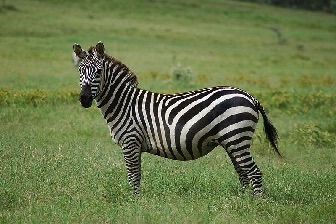

# VLM models via OpenAI API {#ovms_demos_continuous_batching_vlm}

This demo shows how to deploy Vision Language Models in the OpenVINO Model Server.
Text generation use case is exposed via OpenAI API `chat/completions` and `responses` endpoints.

> **Note:** This demo uses [OpenVINO/LFM3-VL-2B-int4-ov](https://huggingface.co/OpenVINO/LFM3-VL-2B-int4-ov) for both image and video requests. Video requests require a build that supports MP4 decoding.

## Prerequisites

**Model Server deployment**: Installed Docker Engine or OVMS binary package according to the [baremetal deployment guide](../../../docs/deploying_server_baremetal.md)

**(Optional) Client**: git and Python for using OpenAI client package and vLLM benchmark app


## Fast deployment with OpenVINO models pulled directly from HuggingFace Hub
VLM models can be deployed in a single command by using pre-configured models from [OpenVINO HuggingFace organization](https://huggingface.co/OpenVINO)
Here is an example of `LFM3-VL-2B-int4` deployment:

:::{dropdown} **Deploying with Docker**

Running this command starts the container:
```bash
mkdir -p models
# in case GPU is available
export GPU_ARGS=$(if ls /dev/dri/render* >/dev/null 2>&1; then echo "--device /dev/dri --group-add $(stat -c '%g' /dev/dri/render* | head -n1)"; fi)
docker run -d ${GPU_ARGS} -u $(id -u):$(id -g) --rm -p 8000:8000 -v ${HOME}/models:/models:rw -e OVMS_MEDIA_URL_ALLOW_REDIRECTS=1 openvino/model_server:weekly --rest_port 8000 --source_model OpenVINO/LFM3-VL-2B-int4-ov --model_repository_path /models --allowed_media_domains raw.githubusercontent.com,storage.openvinotoolkit.org
```
:::

:::{dropdown} **Deploying on Bare Metal**

If you run on GPU make sure to have appropriate drivers installed, so the device is accessible for the model server.

```bat
mkdir c:\models
set OVMS_MEDIA_URL_ALLOW_REDIRECTS=1
ovms --rest_port 8000 --source_model OpenVINO/LFM3-VL-2B-int4-ov --model_repository_path c:\models --allowed_media_domains raw.githubusercontent.com,storage.openvinotoolkit.org
```

:::

## Readiness Check

Wait for the model to load. You can check the status with a simple command:
```console
curl http://localhost:8000/v1/models
```
```json
{
  "object": "list",
  "data": [
    {
      "id": "OpenVINO/LFM3-VL-2B-int4-ov",
      "object": "model",
      "created": 1772928358,
      "owned_by": "OVMS",
      "max_model_len": 128000
    }
  ]
}
```

## Request Generation

Let's send a request with text an image in the messages context.
 

:::{dropdown} **Unary call with curl using image url**
**Note**: using urls in request requires `--allowed_media_domains` parameter described [here](../../../docs/parameters.md)

```bash
curl http://localhost:8000/v1/chat/completions \
  -H "Content-Type: application/json" \
  -d '{
    "model": "OpenVINO/LFM3-VL-2B-int4-ov",
    "messages": [
      {
        "role": "user",
        "content": [
          {
            "type": "text",
            "text": "Describe what is on the picture."
          },
          {
            "type": "image_url",
            "image_url": {
              "url": "http://raw.githubusercontent.com/openvinotoolkit/model_server/refs/heads/main/demos/common/static/images/zebra.jpeg"
            }
          }
        ]
      }
    ],
    "max_completion_tokens": 2048
  }'
```

```json
{
  "choices": [
    {
      "finish_reason": "stop",
      "index": 0,
      "logprobs": null,
      "message": {
        "content": "The picture shows a single zebra standing in an open grassy field. The animal is captured in side/three‑quarter view, with its body oriented toward the left and its head turned so that it looks partly toward the camera. Its coat displays the characteristic bold black‑and‑white striped pattern covering the neck, torso, legs, and face, and it has a short, upright (erect) mane running along the top of the neck as well as a dark tail hanging at the rear. The zebra is standing on green grass; the foreground is a lawn‑like grassland, while the background rises into a gently sloping green hillside or meadow that is softly out of focus, giving a sense of depth. There are no other animals, people, or objects in the scene—just the lone zebra against the green pasture under natural daylight. In short, it is a wildlife/nature photograph of a zebra in a grassy field.",
        "reasoning_content": "The user wants a description of the image. Let me look carefully and reduce uncertainty about what's actually present.\n\nSubject: A single zebra. It's standing in profile, body facing left but head turned slightly toward the viewer/camera. The stripes are black and white—classic zebra pattern. The mane is upright/erect along the neck, dark with some white. The tail is visible, dark, hanging down with a tufted end.\n\nSetting: A grassy field/pasture. Green grass in the foreground where the zebra stands, and the background is a sloping green hillside or meadow, slightly out of focus, suggesting depth. There might be some yellowish patches (dried grass or flowers) in the mid-background. No other animals or people visible.\n\nLighting: daylight, fairly even, maybe overcast or bright but no harsh shadows. The zebra looks healthy.\n\nComposition: zebra centered-ish, occupying middle of frame. Background blurred (shallow depth of field).\n\nI should describe it clearly and concisly but completely. The instruction says \"Describe what is on the picture.\" So I'll provide a coherent paragraph.\n\nLet me make sure not to over-interpret. The zebra appears to be an adult. Could mention it's standing still, alert posture.\n\nI'll write the final answer in English.",
        "role": "assistant",
        "tool_calls": []
      }
    }
  ],
  "created": 1795513597,
  "model": "OpenVINO/LFM3-VL-2B-int4-ov",
  "object": "chat.completion",
  "usage": {
    "prompt_tokens": 89,
    "completion_tokens": 478,
    "total_tokens": 567,
    "prompt_tokens_details": {
      "cached_tokens": 0
    }
  }
}
```
:::

:::{dropdown} **Unary call with cURL using Responses API**
**Note**: Using urls in request requires `--allowed_media_domains` parameter described [here](../../../docs/parameters.md)

```bash
curl http://localhost:8000/v1/responses \
  -H "Content-Type: application/json" \
  -d '{
    "model": "OpenVINO/LFM3-VL-2B-int4-ov",
    "input": [
      {
        "role": "user",
        "content": [
          {
            "type": "input_text",
            "text": "Describe what is on the picture."
          },
          {
            "type": "input_image",
            "image_url": "http://raw.githubusercontent.com/openvinotoolkit/model_server/refs/heads/main/demos/common/static/images/zebra.jpeg"
          }
        ]
      }
    ],
    "max_output_tokens": 2048
  }'
```

```json
{
  "id": "resp-1795513600",
  "object": "response",
  "created_at": 1795513600,
  "completed_at": 1795513602,
  "error": null,
  "model": "OpenVINO/LFM3-VL-2B-int4-ov",
  "status": "completed",
  "parallel_tool_calls": true,
  "store": true,
  "text": {
    "format": {
      "type": "text"
    }
  },
  "tool_choice": "none",
  "tools": [],
  "truncation": "disabled",
  "metadata": {},
  "max_output_tokens": 2048,
  "output": [
    {
      "id": "rs-0",
      "type": "reasoning",
      "summary": [
        {
          "type": "summary_text",
          "text": "The user wants a description of the image. Let me look carefully and reduce uncertainty about what's actually present.\n\nSubject: A single zebra. It's standing in profile, body facing left but head turned slightly toward the viewer/camera. The stripes are black and white—classic zebra pattern. The mane is upright/erect along the neck, dark with some white tips. The tail is visible, dark, hanging down at the rear.\n\nSetting: A grassy field/pasture. Green grass, somewhat lush, covering the ground. The background is a sloping hillside or open field, also green, slightly out of focus / blurred, suggesting depth of field. There might be some yellowish patches (dried grass or flowers) in the mid-background. No other animals, no sky visible really—just green expanse.\n\nLighting: daylight, natural. The zebra appears to be an adult, possibly a plains zebra given the broad stripes.\n\nComposition: zebra centered-ish, occupying middle of frame. The image quality looks like a photograph, perhaps slightly low resolution.\n\nI should describe it clearly and concisly but completely. Mention posture, orientation, stripe details, mane, tail, the grassy environment, blurred background.\n\nLet me make sure I don't over-claim species. I'll say \"zebra\" and note it resembles a plains zebra.\n\nFinal answer in English, a paragraph or two."
        }
      ]
    },
    {
      "id": "msg-0",
      "type": "message",
      "role": "assistant",
      "status": "completed",
      "content": [
        {
          "type": "output_text",
          "text": "The picture shows a single zebra standing in an open, grassy field. The animal is captured in side profile, with its body oriented toward the left of the frame while its head is turned slightly so that it looks partly toward the camera. Its coat displays the characteristic bold black‑and‑white striped pattern, with vertical stripes across the torso and horizontal bands on the legs; the mane stands upright along the neck, and a dark, tufted tail hangs down at the rear. The zebra is surrounded by green grass that covers the ground, and the background consists of a gently sloping, out‑of‑focus green pasture or hillside, giving the impression of a natural savanna or grassland habitat. The lighting appears to be natural daylight, and there are no other animals or objects in the scene—just the lone zebra set against the green grassy backdrop.",
          "annotations": []
        }
      ]
    }
  ],
  "usage": {
    "input_tokens": 89,
    "input_tokens_details": {
      "cached_tokens": 0
    },
    "output_tokens": 482,
    "total_tokens": 571
  }
}
```
:::

:::{dropdown} **Unary call with python requests library**

```console
pip3 install requests
curl https://raw.githubusercontent.com/openvinotoolkit/model_server/refs/heads/main/demos/common/static/images/zebra.jpeg -o zebra.jpeg
```
```python
import requests
import base64
base_url='http://127.0.0.1:8000/v1'
model_name = "OpenVINO/LFM3-VL-2B-int4-ov"

def convert_image(Image):
    with open(Image,'rb' ) as file:
        base64_image = base64.b64encode(file.read()).decode("utf-8")
    return base64_image

payload = {"model": model_name,
    "messages": [
        {
            "role": "user",
            "content": [
              {"type": "text", "text": "Describe what is on the picture."},
              {"type": "image_url", "image_url": {"url": f"data:image/jpeg;base64,{convert_image('zebra.jpeg')}"}}
            ]
        }
        ],
    "max_completion_tokens": 2048
}
headers = {"Content-Type": "application/json", "Authorization": "not used"}
response = requests.post(base_url + "/chat/completions", json=payload, headers=headers)
print(response.text)
```

```json
{
  "choices": [
    {
      "finish_reason": "stop",
      "index": 0,
      "logprobs": null,
      "message": {
        "content": "The picture shows a single zebra standing in an open, grassy field. The animal is captured in side/three‑quarter view, with its body oriented to the left and its head turned so that it looks partly toward the camera, giving an alert appearance. Its coat displays the characteristic bold black‑and‑white striped pattern covering the whole body, including the legs; the short, stiff mane runs upright along the neck, and the tail hangs down at the rear with a dark, tufted tip. The zebra is surrounded by green grass, with some slightly yellowed or drier patches farther back, and the background rises into a softly blurred grassy slope or hillside, indicating an outdoor, natural setting such as a savanna or pasture. The lighting appears to be natural daylight, and there are no other animals or people visible—just the lone zebra against the green grassland.",
        "reasoning_content": "The user wants a description of the image. Let me look carefully and reduce uncertainty about what's actually present.\n\nSubject: A single zebra. It's standing in profile, body facing left but head turned slightly toward the viewer/camera. The stripes are black and white—classic zebra pattern. The mane is upright/erect along the neck, dark with some white. The tail is visible, dark, hanging down with a tufted end.\n\nSetting: A grassy field, green grass, somewhat lush but with some yellowish/dry patches in the background. The background is a sloping hillside or open grassland, slightly out of focus, suggesting depth. The foreground grass is greener where the zebra stands.\n\nLighting: daylight, natural. The zebra appears to be an adult, possibly a plains zebra given the broad stripes.\n\nComposition: Zebra centered-ish, occupying middle of frame. No other animals or people.\n\nI should describe it clearly and concisly. Maybe mention posture: standing, alert, looking toward camera. Mention the environment: grassland/savanna-like but green.\n\nLet me ensure I don't over-claim species. I'll say \"zebra.\"\n\nI'll write a coherent paragraph.\n\nNo need for tools. Final answer in English.",
        "role": "assistant",
        "tool_calls": []
      }
    }
  ],
  "created": 1795513603,
  "model": "OpenVINO/LFM3-VL-2B-int4-ov",
  "object": "chat.completion",
  "usage": {
    "prompt_tokens": 89,
    "completion_tokens": 454,
    "total_tokens": 543,
    "prompt_tokens_details": {
      "cached_tokens": 0
    }
  }
}
```
:::
:::{dropdown} **Streaming request with OpenAI client using chat/completions**

The endpoints `chat/completions` and `responses` are compatible with OpenAI client so it can be easily used to generate code also in streaming mode:

Install the client library:
```console
pip3 install openai
```
```python
from openai import OpenAI
import base64
base_url='http://localhost:8000/v1'
model_name = "OpenVINO/LFM3-VL-2B-int4-ov"

client = OpenAI(api_key='unused', base_url=base_url)

def convert_image(Image):
    with open(Image,'rb' ) as file:
        base64_image = base64.b64encode(file.read()).decode("utf-8")
    return base64_image

stream = client.chat.completions.create(
    model=model_name,
    messages=[
        {
            "role": "user",
            "content": [
              {"type": "text", "text": "Describe what is on the picture."},
              {"type": "image_url", "image_url": {"url": f"data:image/jpeg;base64,{convert_image('zebra.jpeg')}"}}
            ]
        }
        ],
    stream=True,
)
for chunk in stream:
    if chunk.choices[0].delta.content is not None:
        print(chunk.choices[0].delta.content, end="", flush=True)
```

Output:
```
The picture shows a single zebra standing in an open, grassy field. The animal is captured in side profile, with its body facing to the right but its head turned toward the camera, so its face looks almost front-on. It has the classic black-and-white striped coat, vertical bands across the torso that become more horizontal down the legs, and a short, upright mane running along the top of its neck. Its dark muzzle, ears, and tail (with a tufted end) are clearly visible. The zebra is surrounded by green grass that covers the foreground and extends into the background, where the terrain rises gently into a softly blurred grassland/savanna-like slope. The overall scene is a natural outdoor setting, likely a grassland or savanna, with the zebra as the central subject.
```

:::

:::{dropdown} **Streaming request with OpenAI client via Responses API**

```console
pip3 install openai
```
```python
from openai import OpenAI
import base64
base_url='http://localhost:8000/v1'
model_name = "OpenVINO/LFM3-VL-2B-int4-ov"

client = OpenAI(api_key='unused', base_url=base_url)

def convert_image(Image):
    with open(Image,'rb' ) as file:
        base64_image = base64.b64encode(file.read()).decode("utf-8")
    return base64_image

stream = client.responses.create(
    model=model_name,
    input=[
        {
            "role": "user",
            "content": [
              {"type": "input_text", "text": "Describe what is on the picture."},
              {"type": "input_image", "image_url": f"data:image/jpeg;base64,{convert_image('zebra.jpeg')}"}
            ]
        }
        ],
    stream=True,
)
for event in stream:
    if event.type == "response.output_text.delta":
        print(event.delta, end="", flush=True)
```

Output:
```
The picture shows a single zebra standing in an open, grassy field. The animal is captured in a side-on stance with its body facing to the right, while its head is turned toward the camera, so we see its face looking out at the viewer. It has the characteristic black-and-white striped coat, vertical stripes running down the neck and torso that shift to more horizontal bands across the hindquarters, and a short, upright striped mane along the neck. Its dark muzzle, ears, and tail (with a dark tufted end) are clearly visible. The zebra is positioned in the middle of the frame, surrounded by green grass that fills the foreground and background; the grassland behind it is slightly blurred, giving a sense of an outdoor pasture or savanna setting under natural daylight. In short, it is a photograph of a lone zebra standing in a grassy field.
```

:::

## Describe an MP4 video with Chat Completions

This example uses [LFM3-VL-2B](https://huggingface.co/OpenVINO/LFM3-VL-2B-int4-ov) to describe a [30-second Intel commercial](https://storage.openvinotoolkit.org/repositories/openvino_notebooks/data/data/video/Sheldon%20Cooper%20Jim%20Parsons%20at%20Intels%20Lab.mp4). Pass the H.264 MP4 URL as a string in `video_url.url`. OVMS downloads the video, decodes and samples frames on the server, and passes those frames to the model. The client does not need to extract frames, and the model does not receive the audio track.

See the [Chat Completions API reference](../../../docs/model_server_rest_api_chat.md) for video input formats and sampling behavior. The [deployment parameters](../../../docs/parameters.md) include `--input_video_fps` and `--input_video_max_frames`; [input media decode protection](../../../docs/parameters.md#input-media-decode-protection) documents encoded-file size and decoded-pixel limits.

Use the deployment above for this request. Unlike the image examples, video requests use only Chat Completions: the [Responses API](../../../docs/model_server_rest_api_responses.md) supports text and image inputs, not `video_url` content parts.

:::{dropdown} **Unary call with curl using video url**

```bash
curl --silent --show-error --fail-with-body \
  http://localhost:8000/v1/chat/completions \
  -H 'Content-Type: application/json' -d '{
  "model": "OpenVINO/LFM3-VL-2B-int4-ov",
  "messages": [
    {
      "role": "user",
      "content": [
        {"type": "text", "text": "Describe this video. What happens in it?"},
        {
          "type": "video_url",
          "video_url": {
            "url": "https://storage.openvinotoolkit.org/repositories/openvino_notebooks/data/data/video/Sheldon%20Cooper%20Jim%20Parsons%20at%20Intels%20Lab.mp4"
          }
        }
      ]
    }
  ],
  "temperature": 0.0,
  "max_completion_tokens": 2048
}'
```

In the response, `choices[0].message.content` contains the description and `usage.completion_tokens` reports the number of generated tokens. See the [Chat Completions API reference](../../../docs/model_server_rest_api_chat.md) for supported video inputs and frame limits.
:::

## Testing the model accuracy over serving API

Check the [guide of using lm-evaluation-harness](../accuracy/README.md)


## References
- [Official OpenVINO LLM models in HuggingFace](https://huggingface.co/collections/OpenVINO/llm)
- [Supported VLM models](https://openvinotoolkit.github.io/openvino.genai/docs/supported-models/#visual-language-models-vlms)
- [Export models to OpenVINO format](../../../demos/common/export_models/README.md)
- [Chat Completions API](../../../docs/model_server_rest_api_chat.md)
- [Responses API](../../../docs/model_server_rest_api_responses.md)
- [Writing client code](../../../docs/clients_genai.md)
- [LLM calculator reference](../../../docs/llm/reference.md)
