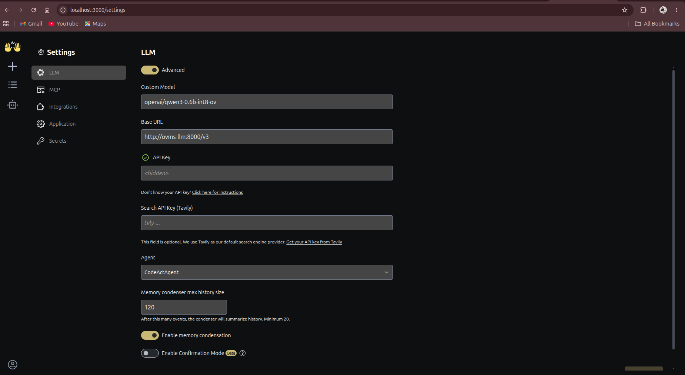
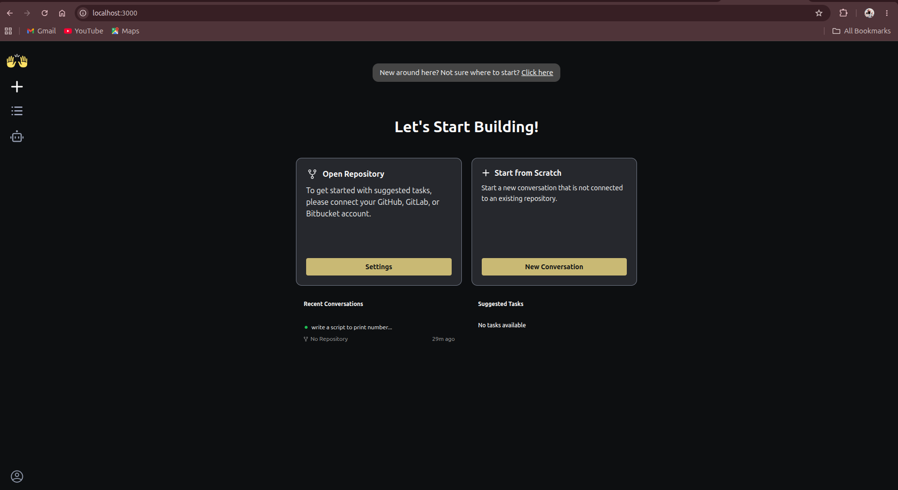

# OpenHands with OpenVINO Model Server {#ovms_demos_integration_with_openhands}

## Description

[OpenHands](https://github.com/All-Hands-AI/OpenHands) is an open-source software engineering agent that can reason over multi-step tasks, write code, run commands in isolated sandboxes, and inspect the results. This demo configures OpenHands to use a model served by [OpenVINO Model Server](https://github.com/openvinotoolkit/model_server) through the OpenAI-compatible REST API.

---

## Setup

### Prerequisites

Requirements:
* Linux host with x86_64 architecture
* [Docker Engine](https://docs.docker.com/engine/) and the Docker Compose v2 plugin
* `envsubst` from the `gettext` package
* 16 GB RAM or more, plus enough disk space for the model and container images
* Access to `ghcr.io` to download the OpenHands application and runtime images
* An Intel GPU supported by OpenVINO for the optional GPU deployment
* A Hugging Face token in `HF_TOKEN` when the selected model requires authentication

Clone the repository and enter the demo directory:

```bash
git clone https://github.com/openvinotoolkit/model_server.git
cd model_server/demos/integration_with_OpenHands
```

## Step 1: Start OVMS and OpenHands

The deployment helper pulls the requested model into a local cache, generates `docker-compose.yml`, and starts both services. The default model is only an example; the same procedure applies to other OpenVINO text-generation models from the [OpenVINO model collection](https://huggingface.co/OpenVINO).

For CPU inference:

```bash
./scripts/deploy_model_ovms.sh OpenVINO/Qwen3-8b-int8-ov --device CPU
```

For GPU inference:

```bash
./scripts/deploy_model_ovms.sh OpenVINO/Qwen3-8b-int8-ov --device GPU
```

For gated models, export the token before running the helper:

```bash
export HF_TOKEN="your_token_here"
```

The default published ports are `8000` for OVMS and `3000` for OpenHands. If either port is already in use, the helper reports it before starting containers. Select unused host ports with environment variables, for example:

```bash
OVMS_REST_PORT=8001 OPENHANDS_PORT=3001 \
  ./scripts/deploy_model_ovms.sh OpenVINO/Qwen3-8b-int8-ov --device CPU
```

Use `--cache-dir` to change the model cache location and `--skip-wait` to return while OVMS downloads and loads the model. Run `./scripts/deploy_model_ovms.sh --help` for all options.

## Step 2: Verify OVMS

Check that the model is available:

```bash
curl http://localhost:${OVMS_REST_PORT:-8000}/v1/config
```

The response should contain `"model_status": "AVAILABLE"`. Send a request through the same OpenAI-compatible endpoint used by OpenHands:

```bash
curl -X POST http://localhost:${OVMS_REST_PORT:-8000}/v3/chat/completions \
  -H "Content-Type: application/json" \
  -d '{
    "model": "qwen3-8b-int8-ov",
    "messages": [{"role": "user", "content": "Say this is a test"}],
    "max_tokens": 10
  }'
```

The model name is the lowercase final component of the Hugging Face repository ID. Override it with `LOCAL_NAME` when needed.

## Step 3: Start an OpenHands Task

Open [http://localhost:3000](http://localhost:3000), or use the configured `OPENHANDS_PORT`. The helper preconfigures the first-run LLM settings in `.openhands/settings.json`, so the **AI Provider Configuration** window is skipped on a fresh deployment. Existing OpenHands settings are preserved when the helper is run again.

To verify or change the connection later, open **Settings** > **LLM**. For the example model, the values are:

* **Custom Model:** `openai/qwen3-8b-int8-ov`
* **Base URL:** `http://ovms-llm:8000/v3`
* **API Key:** `unused`



Create a task such as:

```text
Create a Python function that calculates the factorial of a number and run a test.
```

OpenHands should create a sandbox, write the implementation, and execute the test. The deployment explicitly enables native OpenAI-compatible tool calling for the custom OVMS model. This ensures tools such as `str_replace_editor` receive all required structured arguments, including OpenHands' `security_risk` assessment. The helper also pins a prebuilt runtime image matching the OpenHands application version, so the first task starts a sandbox directly instead of building one with `apt-get`. The initial image pull can take several minutes. Host proxy settings are bypassed for `host.docker.internal`, which OpenHands uses to contact its runtime sandbox.

If the UI remains on **Building runtime**, recreate the failed conversation after confirming the current helper completed successfully. OpenHands does not recover an already failed runtime build in place. Diagnose container or image errors with:

```bash
docker logs openhands
docker ps -a --filter name=openhands-runtime
docker images ghcr.io/all-hands-ai/runtime
```



> The OVMS base URL is an internal Docker network address. Use `http://localhost:8000/v3` only for clients running directly on the host.

To confirm that requests reach OVMS, run:

```bash
docker compose -f docker-compose.yml logs -f ovms-llm
```

## Container Management

Use the generated Compose file for routine operations:

```bash
docker compose -f docker-compose.yml ps
docker compose -f docker-compose.yml logs -f
docker compose -f docker-compose.yml restart
docker compose -f docker-compose.yml down
```

The script regenerates `docker-compose.yml` when the model, device, image, or ports change.

## References

* [OpenHands documentation](https://docs.all-hands.dev/)
* [OpenVINO model collection](https://huggingface.co/OpenVINO)
* [OpenVINO Model Server chat API](../../docs/model_server_rest_api_chat.md)
