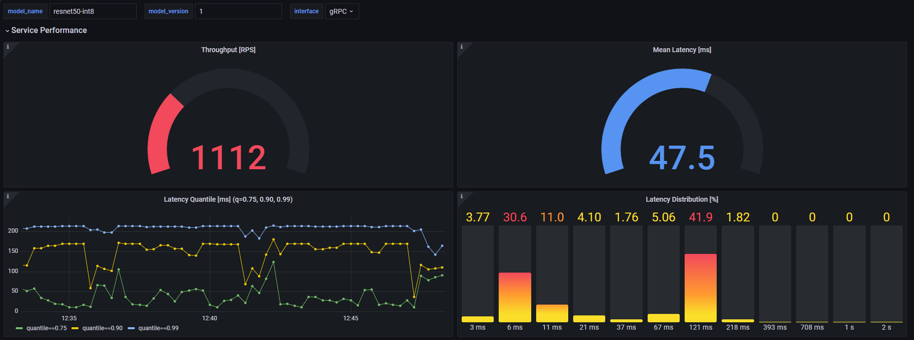
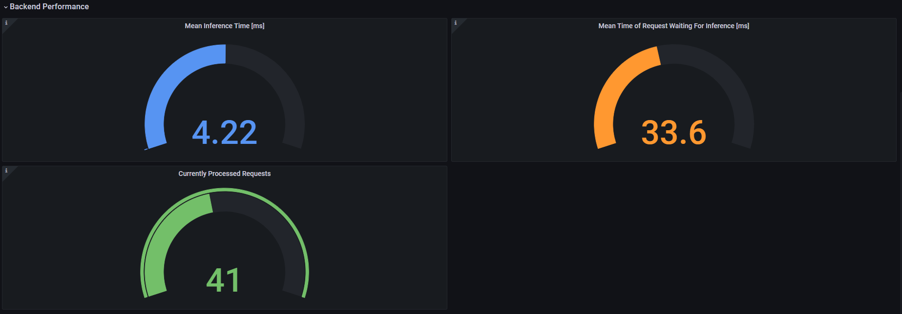

# Metrics {#ovms_docs_metrics}

## Introduction

This document describes how to use metrics endpoint in the OpenVINO Model Server. They can be applied for:

- Providing performance and utilization statistics for monitoring and benchmarking purposes

- Auto scaling of the model server instances in Kubernetes and OpenShift based on application related metrics

Built-in metrics allow tracking the performance without any extra logic on the client side or using network traffic monitoring tools like load balancers or reverse-proxies.

It also exposes metrics which are not related to the network traffic. 

For example, statistics of the inference execution queue, model runtime parameters etc. They can also track the usage based on model version, API type or requested endpoint methods.

OpenVINO Model Server metrics are compatible with [Prometheus standard](https://prometheus.io/docs)

They are exposed on the `/metrics` endpoint.

## Available metrics families

Metrics from default list are enabled with the `metrics_enable` flag or json configuration.

However, you can enable also additional metrics by listing all the metrics you want to enable in the `metric_list` flag or json configuration.


Default metrics
| Type      | Name | Labels | Description |
| :---    |    :----   |    :----   |    :----       |
| gauge      | ovms_streams | name,version | Number of OpenVINO execution streams. |
| gauge      | ovms_current_requests | name,version | Number of requests being currently processed by the model server. |
| gauge      | ovms_current_graphs | name | Number of MediaPipe graphs in process. |
| gauge      | ovms_graph_loaded | name | Whether MediaPipe graph resources are loaded (`1`) or idle-unloaded (`0`). |
| counter      | ovms_requests_success | api,interface,method,name,version | Number of successful requests to a model or a DAG. |
| counter      | ovms_requests_fail | api,interface,method,name,version | Number of failed requests to a model or a DAG. |
| counter      | ovms_requests_accepted | api,interface,method,name | Number of accepted requests which ended up inserting packet(s) into a MediaPipe graph. |
| counter      | ovms_requests_rejected | api,interface,method,name | Number of rejected which failed at MediaPipe packet creation step. |
| counter      | ovms_responses | api,interface,method,name | Number of responses generated by the MediaPipe graph. |
| histogram      | ovms_request_time_us | interface,name,version | Processing time of requests to a model or a DAG. |
| histogram      | ovms_inference_time_us | name,version | Inference execution time in the OpenVINO backend. |
| histogram      | ovms_wait_for_infer_req_time_us | name,version | Request waiting time in the scheduling queue. Indicates how long the request has to wait before required resources are assigned to it. |

Optional metrics
| Type      | Name | Labels | Description |
| :---    |    :----   |    :----   |    :----       |
| gauge      | ovms_infer_req_queue_size | name,version | Inference request queue size (nireq). |
| gauge      | ovms_infer_req_active | name,version | Number of currently consumed inference requests from the processing queue that are now either in the data loading or inference process. |
| gauge      | ovms_kv_cache_utilization_percent | name,node | GenAI-reported cache utilization (0-100) for a continuous-batching LLM or VLM pipeline. |
| gauge      | ovms_kv_cache_size_bytes | name,node | GenAI-reported KV-cache size in bytes for a continuous-batching LLM or VLM pipeline. |
| counter      | ovms_llm_prompt_tokens_total | name,node | Input prompt tokens from successfully completed continuous-batching LLM/VLM requests, as reported by GenAI. |
| counter      | ovms_llm_generated_tokens_total | name,node | Generated output tokens from successfully completed continuous-batching LLM/VLM requests; excludes partial output from failed or cancelled requests. |
| gauge      | ovms_llm_scheduled_requests | name,node | Number of requests scheduled in the last continuous-batching generation step; set to zero when the executor becomes idle. |
| histogram      | ovms_llm_ttft_milliseconds | name,node | GenAI time to first token in milliseconds for successfully completed continuous-batching LLM/VLM requests, excluding VLM embedding preparation. |
| histogram      | ovms_llm_tpot_milliseconds | name,node | GenAI time per output token in milliseconds for successfully completed continuous-batching LLM/VLM requests. |

> **Note**: While `ovms_current_requests` and `ovms_infer_req_active` both indicate how much resources are engaged in the requests processing, they are quite distinct. A request is counted in `ovms_current_requests` metric starting as soon as it's received by the server and stays there until the response is sent back to the user. The `ovms_infer_req_active` counter informs about the number of OpenVINO Infer Requests that are bound to user requests and are either loading the data or already running inference. 

Labels description
| Name      | Values |  Description |
| :---    |    :----   |    :----   |
| api      | KServe, TensorFlowServing, V3  | Name of the serving API. |
| interface      | REST, gRPC | Name of the serving interface. |
| method      | ModelMetadata, ModelReady, ModelInfer, Predict, GetModelStatus, GetModelMetadata, Unary, Stream | Interface methods. |
| version      | 1, 2, ..., n | Model version. Note that GetModelStatus and ModelReady and all MediaPipe servables do not have the version label. |
| name      | As defined in model server config | Model name, DAG name or MediaPipe graph name. |
| node      | As defined in the graph configuration | LLM calculator node name; distinguishes independent pipelines within a graph. |

## LLM-specific metrics

The currently supported GenAI metric families are optional and supported for
continuous-batching language and vision-language models, not legacy/NPU or Omni
pipelines. Use the `all_llm` preset in the metrics list to enable all seven, or
list individual families:

```text
ovms --config_path /models/config.json --rest_port 8000 --metrics_enable --metrics_list all_llm
curl http://localhost:8000/metrics
```

The preset can also be used in `monitoring.metrics.metrics_list` in the
configuration file. An explicit list selects only the listed families; include
other metric names if you also need the default serving metrics. The preset
includes only currently supported LLM metric families; it does not enable
proposed or future LLM metrics automatically.

The scheduled-request gauge is refreshed after every generation step. Cache
utilization and cache-size gauges are refreshed every 10 generation steps and
when the executor becomes idle, before waiting for new requests. Scrapes return
the latest published values; cache changes between updates may not be visible.

Cache utilization is GenAI's maximum utilization percentage across registered
cache types, not total device-memory utilization. Its denominator can change
with dynamic cache allocation. While a pipeline is waiting for new requests,
cache gauges retain their latest values; waiting does not imply an empty cache
or zero utilization. KV-cache size is reported in bytes and can also change
with dynamic allocation; it is not total device memory.

### LLM metric series lifecycle

LLM metric series are identified by the graph and node name and are owned by the
metric registry, which keeps them until the server stops. Graph unload,
idle-unload and reload do not remove or reset them: the reloaded pipeline
continues the same series, so token counters and timing histograms keep
accumulating. A request that completes on the previous pipeline after a reload
is counted in the same series. Counters reset only on server restart;
Prometheus handles that in `rate()` and `increase()`.

The cache utilization, cache size and scheduled-request gauges describe the
running pipeline. OVMS sets them to `0` when the pipeline stops, so an unloaded
graph does not keep exporting its last values. After a reload the previous
pipeline can stay alive until its requests finish; only the newest pipeline of a
graph node updates these gauges, so the previous one cannot overwrite or reset
the values of its replacement.

Prompt and generated-token counters increase once per successfully completed
request, for both unary and streaming responses. Failed and cancelled requests
are excluded. Since counters update at completion, their rates do not include
tokens from requests still in progress. For example, aggregate prompt and
generated-token rates over five minutes are:

```promql
sum by (name, node) (rate(ovms_llm_prompt_tokens_total[5m]))
sum by (name, node) (rate(ovms_llm_generated_tokens_total[5m]))
```

Streaming requests are recorded once, at final response, not once per chunk.

TTFT and TPOT are GenAI request timings, not HTTP end-to-end latency. For VLMs,
TTFT excludes embedding preparation. The histograms export `_bucket`, `_sum`,
and `_count` series. Their finite bucket boundaries, in milliseconds, are
`1, 5, 10, 20, 40, 60, 80, 100, 250, 500, 750, 1000, 2500, 5000, 7500,
10000, 20000, 40000, 80000, 160000, 640000` for TTFT, and
`10, 20, 40, 60, 80, 100, 250, 500, 750, 1000, 2500, 5000, 7500, 10000,
20000, 40000, 80000` for TPOT. Only finite, strictly positive samples are observed;
an invalid timing sample is skipped without discarding the request's token counts
or the other valid timing sample.

The scheduled-requests gauge reports GenAI's count from the latest generation
step. It is zero while the pipeline is waiting for new requests. It is not the
waiting queue size or the total number of requests accepted by the server.

## Enable metrics

By default, the metrics feature is disabled.

Metrics endpoint is using the same port as the REST interface for running the model queries.

It is required to enable REST in the model server by setting the parameter --rest_port.

To enable default metrics set you need to specify the `metrics_enable` flag or json setting:

### Option 1: CLI

 ```bash
mkdir -p ${HOME}/models
curl -L https://huggingface.co/OpenVINO/resnet50-int8-ov/resolve/main/resnet50.bin -o ${HOME}/models/resnet50.bin
curl -L https://huggingface.co/OpenVINO/resnet50-int8-ov/resolve/main/resnet50.xml -o ${HOME}/models/resnet50.xml
docker run -d -u $(id -u) -v ${HOME}/models:/models -p 9000:9000 -p 8000:8000 openvino/model_server:latest \
       --model_name resnet --model_path /models/resnet50.xml \
       --mean "[123.675,116.28,103.53]" --scale "[58.395,57.12,57.375]" --layout "NHWC:NCHW" --port 9000 \
       --rest_port 8000 \
       --metrics_enable
 ```

### Option 2: Configuration file

```bash
mkdir -p workspace
curl -L https://huggingface.co/OpenVINO/resnet50-int8-ov/resolve/main/resnet50.bin -o workspace/resnet50.bin
curl -L https://huggingface.co/OpenVINO/resnet50-int8-ov/resolve/main/resnet50.xml -o workspace/resnet50.xml
echo '{
 "model_config_list": [
     {
        "config": {
             "name": "resnet",
             "base_path": "/workspace/resnet50.xml",
             "mean": "[123.675,116.28,103.53]",
             "scale": "[58.395,57.12,57.375]",
             "layout": "NHWC:NCHW"
        }
     }
 ],
 "monitoring":
     {
         "metrics":
         {
             "enable" : true
         }
     }
}' >> workspace/config.json
```

### Start with configuration file

```bash
docker run -d -u $(id -u) -v ${PWD}/workspace:/workspace -p 9000:9000 -p 8000:8000 openvino/model_server:latest \
       --config_path /workspace/config.json \
       --port 9000 --rest_port 8000
```

## Change the default list of metrics

You can enable from one up to all the metrics available at once.

To enable specific set of metrics you need to specify the metrics_list flag or json setting:

### Option 1: CLI

```bash
mkdir -p ${HOME}/models
curl -L https://huggingface.co/OpenVINO/resnet50-int8-ov/resolve/main/resnet50.bin -o ${HOME}/models/resnet50.bin
curl -L https://huggingface.co/OpenVINO/resnet50-int8-ov/resolve/main/resnet50.xml -o ${HOME}/models/resnet50.xml
docker run -d -u $(id -u) -v ${HOME}/models:/models -p 9000:9000 -p 8000:8000 openvino/model_server:latest \
      --model_name resnet --model_path /models/resnet50.xml \
      --mean "[123.675,116.28,103.53]" --scale "[58.395,57.12,57.375]" --layout "NHWC:NCHW" --port 9000 \
      --rest_port 8000 \
      --metrics_enable \
      --metrics_list ovms_requests_success,ovms_infer_req_queue_size
```

### Option 2: Configuration file

```bash
mkdir -p workspace
curl -L https://huggingface.co/OpenVINO/resnet50-int8-ov/resolve/main/resnet50.bin -o workspace/resnet50.bin
curl -L https://huggingface.co/OpenVINO/resnet50-int8-ov/resolve/main/resnet50.xml -o workspace/resnet50.xml
echo '{
 "model_config_list": [
     {
        "config": {
             "name": "resnet",
             "base_path": "/workspace/resnet50.xml",
             "mean": "[123.675,116.28,103.53]",
             "scale": "[58.395,57.12,57.375]",
             "layout": "NHWC:NCHW"
        }
     }
 ],
 "monitoring":
     {
         "metrics":
         {
             "enable" : true,
             "metrics_list": ["ovms_requests_success", "ovms_infer_req_queue_size"]
         }
     }
}' > workspace/config.json
```

### Start with configuration file

```bash
docker run -d -u $(id -u) -v ${PWD}/workspace:/workspace -p 9000:9000 -p 8000:8000 openvino/model_server:latest \
   --config_path /workspace/config.json \
   --port 9000 --rest_port 8000
```

### Configuration file with all metrics enabled

```bash
echo '{
 "model_config_list": [
     {
        "config": {
             "name": "resnet",
             "base_path": "/workspace/resnet50.xml"
        }
     }
 ],
 "monitoring":
     {
         "metrics":
         {
             "enable" : true,
             "metrics_list": 
                 [ "ovms_requests_success",
                 "ovms_requests_fail",
                 "ovms_requests_accepted",
                 "ovms_requests_rejected",
                 "ovms_responses",
                 "ovms_inference_time_us",
                 "ovms_wait_for_infer_req_time_us",
                 "ovms_request_time_us",
                 "ovms_current_requests",
                 "ovms_current_graphs",
                 "ovms_infer_req_active",
                 "ovms_streams",
                 "ovms_infer_req_queue_size"]
         }
     }
}' > workspace/config.json
```

### Start with the configuration file above

```bash
docker run -d -u $(id -u) -v ${PWD}/workspace:/workspace -p 9000:9000 -p 8000:8000 openvino/model_server:latest \
   --config_path /workspace/config.json \
   --port 9000 --rest_port 8000
```

## Example response from metrics endpoint

To use data from metrics endpoint you can use the curl command:
```bash
curl http://localhost:8000/metrics
```
[Example metrics output](https://raw.githubusercontent.com/openvinotoolkit/model_server/main/docs/metrics_output.out)

## Performance considerations
Collecting metrics has negligible performance overhead when used with models of average size and complexity. However when used with very lightweight, fast models which inference time is very short, the metric incrementation can take noticeable proportion of the processing time. Consider it while enabling metrics for such models.

## Metrics implementation for MediaPipe Graphs

For [MediaPipe Graphs](./mediapipe.md) execution there are 6 generic metrics which apply to all graphs:

| Type      | Name  | Description |
| :---    |    :----   |    :----   |
| counter      | ovms_requests_accepted | Counts number of requests which ended up pushing MediaPipe packet down the graph stream. For example image frame in vision use cases, LLM prompt in text generation use cases. |
| counter      | ovms_requests_rejected | Counts errors in MediaPipe packet creation phase. For example bad image format in vision use cases. Please note that for V3 API, the LLM request is validated at graph node level meaning that packet creation always succeeds. Please refer to specific graph definition and implementation. |
| counter      | ovms_responses | Useful to track number of packets generated by MediaPipe graph. Keep in mind that single request may trigger production of multiple (or zero) packets, therefore tracking number of responses is complementary to tracking accepted requests. For example tracking streaming partial responses of LLM text generation graphs. |
| gauge      | ovms_current_graphs | Number of graphs currently in-process. For unary communication it is equal to number of currently processing requests (each request initializes separate MediaPipe graph). For streaming communication it is equal to number of active client connections. Each connection is able to reuse the graph and decide when to delete it when the connection is closed. |
| counter      | ovms_graph_error | Counts errors in MediaPipe graph execution phase. For example V3 LLM text generation fails in LLMCalculator due to missing prompt - calculator returns an error and graph cancels. |
| histogram      | ovms_graph_processing_time_us | Tracks duration of successfully started mediapipe graphs in us. It can represent pipeline processing time for unary calls or the session length for streamed requests. |
| histogram      | ovms_graph_request_latency_us | Difference between MediaPipe packet timestamps at the time of creation (request receival) and when the packet generation has concluded (full or partial response). Server automatically timestamps the incoming  packets and is used as a source of truth for receival time, unless client opts-in to manual timestamping (NOTE: manual timestamping causes the metric results to become invalid). |

## Custom metrics in C++ calculators

Calculators can register **custom counters, gauges, and histograms** and update
them during processing:

```cpp
auto events = metrics->getOrRegisterCounter("custom_events_total", "Events processed.");
events->increment();       // Add one.
events->increment(3.0);    // Add a batch.

auto queueDepth = metrics->getOrRegisterGauge("custom_queue_depth", "Queued requests.");
queueDepth->set(4);
queueDepth->add(-1);

auto latency = metrics->getOrRegisterHistogram(
        "custom_request_duration_seconds", "Request duration.", {0.01, 0.1, 1.0});
latency->observe(0.08);
```

`metrics` is an OVMS-provided `std::shared_ptr<ovms::CalculatorMetrics>`, scoped
to one graph and one named calculator node. Each returned shared pointer is a
thread-safe metric handle, not a local copy of the value. OVMS stores values in
the shared Prometheus registry and exposes them on the existing `/metrics`
endpoint. No separate cache, exporter, background thread or scrape callback is
necessary.

This is a **C++ extension API**: implementing new metric logic requires
compiling the calculator and linking it into OVMS; a graph file alone cannot
define arbitrary metric logic. It does not expose a Python metrics API.

### Enable metrics and add the side packet

Enable the normal metrics endpoint using `--rest_port 8000 --metrics_enable`, or
the equivalent monitoring configuration. Then add this input side packet to the
calculator node in its graph:

```protobuf
node {
        name: "my_node"
        calculator: "MyCalculator"
        input_side_packet: "CALCULATOR_METRICS:calculator_metrics"
        # Other inputs, outputs and calculator options...
}
```

OVMS supplies the packet; do not configure an external side-packet value.
Use the tag and packet name exactly as shown (`CALCULATOR_METRICS:calculator_metrics`).
The node must have a stable, non-empty `name`. Each custom series automatically
gets `name="<graph name>"` and `node="<calculator node name>"` labels.

### Register custom metrics in the calculator

Include `src/metrics/calculator_metrics.hpp` and depend on
`//src/metrics:libovmsmetrics` in the calculator's Bazel target.
Declare the side-packet type in `GetContract`, acquire the node's scope in `Open`,
and retain the returned handle as a calculator member:

```cpp
std::shared_ptr<ovms::CalculatorCounter> events;
std::shared_ptr<ovms::CalculatorGauge> queueDepth;
std::shared_ptr<ovms::CalculatorHistogram> latency;

static absl::Status GetContract(mediapipe::CalculatorContract* cc) {
        // Keep the calculator's existing input/output contract here.
        cc->InputSidePackets()
                .Tag(ovms::CALCULATOR_METRICS_TAG)
                .Set<ovms::CalculatorMetricsMap>();
        return absl::OkStatus();
}

absl::Status Open(mediapipe::CalculatorContext* cc) override {
        const auto& scopes = cc->InputSidePackets()
                .Tag(ovms::CALCULATOR_METRICS_TAG)
                .Get<ovms::CalculatorMetricsMap>();
        const auto scope = scopes.find(cc->NodeName());
        RET_CHECK(scope != scopes.end()) << "Missing calculator metrics scope";
        try {
                events = scope->second->getOrRegisterCounter(
                        "custom_events_total", "Events processed.");
                queueDepth = scope->second->getOrRegisterGauge(
                        "custom_queue_depth", "Queued requests.");
                latency = scope->second->getOrRegisterHistogram(
                        "custom_request_duration_seconds", "Request duration.",
                        {0.01, 0.1, 1.0});
        } catch (const std::exception& e) {
                return absl::InvalidArgumentError(e.what());
        }
        return absl::OkStatus();
}
```

Use the normal MediaPipe headers for these methods, plus `<memory>` and
`<exception>`. For an optional integration, guard both contract declaration and
`Open` lookup with `cc->InputSidePackets().HasTag(ovms::CALCULATOR_METRICS_TAG)`.

Registration is idempotent: identical registrations from concurrent calculator
instances in the same graph/node return the same handle. Register in `Open`,
not for every packet. Different nodes or graphs get independent series.

### Update during processing

Update the retained handles during processing:

```cpp
events->increment();
```

To count multiple events in a packet, call
`events->increment(static_cast<double>(eventCount))`. Use gauges with `set` or
`add` (accepting positive, zero, or negative finite values), and record histogram
samples with `observe`. Histogram bucket boundaries must be finite and strictly
increasing, and the same metric name must use identical boundaries everywhere.
No registry lookup, metric-name construction or registration is needed in
`Process`. Scrapes do not reset counters or histograms; use Prometheus `rate()`
or `increase()` to calculate counter changes over time.

### Naming, configuration and lifetime

- All names must start with `custom_` and contain only ASCII letters, digits
    and underscores. Counters must also end with `_total`; gauges and histograms
    use names that describe the measured quantity. Every metric needs non-empty
    help text. The `custom_` prefix keeps application metrics separate from
    built-in `ovms_` metrics.
- The same metric name must have identical type, help text, and (for histograms)
    bucket boundaries across nodes and graphs. Invalid names and conflicting
    definitions are logged and throw exceptions; do not suppress those errors.
    Non-finite gauge values or histogram observations, and negative or non-finite
    counter increments, are logged as warnings and ignored.
- Metric names must be fixed in calculator code. Do not construct names from
    words, users, requests or timestamps. This initial API intentionally exposes
    only the fixed graph/node labels to keep cardinality bounded.
- Custom metrics are controlled by the global metrics-enable setting and the
    calculator's own registration logic, **not** by the built-in `metrics_list`.
    Do not put custom names in that list: its parser accepts built-in names only.
    Custom metrics still work when a list selects a subset of built-in metrics.
- With metrics disabled, registration returns a valid no-op handle, so processing
    need not contain null checks. Names and values are still validated.
- Metrics persist across requests and calculator `Close` calls. Do not remove
    them in `Close`: other calculator instances can share the series.
- The metric registry owns the series and keeps them until the server stops.
    Graph unload, idle-unload and reload do not remove or reset them: a calculator
    that registers the same metric after a reload continues the existing series,
    and counters and histograms keep their values. Handles retained by a request
    that started before the reload still update that same series.
- Because series outlive the graph, a series of a retired graph or a renamed
    node stays exported with its last value. Set gauges back to their idle value
    in `Close` if a stale value would be misleading.

## Visualize with Grafana

With server metrics being scraped by [Prometheus](https://prometheus.io/) it is possible to integrate [Grafana](https://grafana.com/) to visualize them on the dashboards. Once you have Grafana configured with Prometheus as a data source, you can create your own dashboard or import one. 

In OpenVINO Model Server repository you can find [grafana_dashboard.json](https://github.com/openvinotoolkit/model_server/blob/main/extras/grafana_dashboard.json) file that can be used to visualize per model metrics like:
- Throughput [RPS] - number of requests being processed by the model per second.
- Mean Latency [ms] - latency averaged across all requests processed by the model in a certain timeframe.
- Latency Quantile [ms] - value of latency for quantiles [0.75, 0.90, 0.99], meaning the latency that has NOT been exceeded by 75%, 90% and 99% of the requests.
- Latency Distribution [%] - distribution of the latencies across the buckets.
- Mean Inference Time [ms] - time of inference execution, averaged across all requests processed by the model in a certain timeframe.
- Mean Time of Request Waiting For Inference [ms] - time of a request waiting for the inference execution, averaged across all requests processed by the model in a certain timeframe.
- Currently Processed Requests - Number of requests being currently processed by the model server.

The dashboard works with three variables: `model_name`, `model_version` and `interface` that determine the model instance and interface (gRPC or REST) of interest. The `interface` value is ignored for panels with: `Mean Inference Time`, `Mean Time of Request Waiting For Inference`, `Currently Processed Requests` as they concern only backend performance and are interface agnostic.



