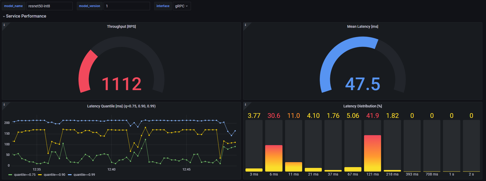
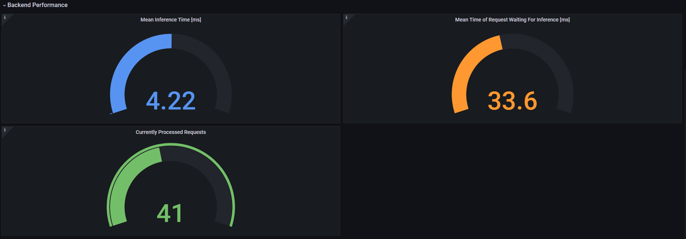

# Metrics {#ovms_docs_metrics}

## Introduction

This document describes how to use metrics endpoint in the OpenVINO Model Server. They can be applied for:

- Providing performance and utilization statistics for monitoring and benchmarking purposes

- Auto scaling of the model server instances in Kubernetes and OpenShift based on application related metrics

Built-in metrics allow tracking the performance without any extra logic on the client side or using network traffic monitoring tools like load balancers or reverse-proxies.

It also exposes metrics which are not related to the network traffic. 

For example, statistics of the inference execution queue, model runtime parameters etc. They can also track the usage based on model version, API type or requested endpoint methods.

OpenVINO Model Server metrics are compatible with [Prometheus standard](https://prometheus.io/docs)

They are exposed on the `/metrics` endpoint.

## Available metrics families

Metrics from default list are enabled with the `metrics_enable` flag or json configuration.

However, you can enable also additional metrics by listing all the metrics you want to enable in the `metric_list` flag or json configuration.


Default metrics
| Type      | Name | Labels | Description |
| :---    |    :----   |    :----   |    :----       |
| gauge      | ovms_streams | name,version | Number of OpenVINO execution streams. |
| gauge      | ovms_current_requests | name,version | Number of requests being currently processed by the model server. |
| gauge      | ovms_current_graphs | name | Number of MediaPipe graphs in process. |
| gauge      | ovms_graph_loaded | name | Whether MediaPipe graph resources are loaded (`1`) or idle-unloaded (`0`). |
| counter      | ovms_requests_success | api,interface,method,name,version | Number of successful requests to a model or a DAG. |
| counter      | ovms_requests_fail | api,interface,method,name,version | Number of failed requests to a model or a DAG. |
| counter      | ovms_requests_accepted | api,interface,method,name | Number of accepted requests which ended up inserting packet(s) into a MediaPipe graph. |
| counter      | ovms_requests_rejected | api,interface,method,name | Number of rejected which failed at MediaPipe packet creation step. |
| counter      | ovms_responses | api,interface,method,name | Number of responses generated by the MediaPipe graph. |
| histogram      | ovms_request_time_us | interface,name,version | Processing time of requests to a model or a DAG. |
| histogram      | ovms_inference_time_us | name,version | Inference execution time in the OpenVINO backend. |
| histogram      | ovms_wait_for_infer_req_time_us | name,version | Request waiting time in the scheduling queue. Indicates how long the request has to wait before required resources are assigned to it. |

Optional metrics
| Type      | Name | Labels | Description |
| :---    |    :----   |    :----   |    :----       |
| gauge      | ovms_infer_req_queue_size | name,version | Inference request queue size (nireq). |
| gauge      | ovms_infer_req_active | name,version | Number of currently consumed inference requests from the processing queue that are now either in the data loading or inference process. |
| gauge      | ovms_llm_kv_cache_utilization_percent | name,node | GenAI-reported cache utilization (0-100) for a continuous-batching LLM or VLM pipeline. |
| histogram      | ovms_llm_prefill_speed_tokens_per_second | name,node | Per-request input token count divided by GenAI time to first token in seconds, for continuous-batching LLM and VLM pipelines. |

> **Note**: While `ovms_current_requests` and `ovms_infer_req_active` both indicate how much resources are engaged in the requests processing, they are quite distinct. A request is counted in `ovms_current_requests` metric starting as soon as it's received by the server and stays there until the response is sent back to the user. The `ovms_infer_req_active` counter informs about the number of OpenVINO Infer Requests that are bound to user requests and are either loading the data or already running inference. 

Labels description
| Name      | Values |  Description |
| :---    |    :----   |    :----   |
| api      | KServe, TensorFlowServing, V3  | Name of the serving API. |
| interface      | REST, gRPC | Name of the serving interface. |
| method      | ModelMetadata, ModelReady, ModelInfer, Predict, GetModelStatus, GetModelMetadata, Unary, Stream | Interface methods. |
| version      | 1, 2, ..., n | Model version. Note that GetModelStatus and ModelReady and all MediaPipe servables do not have the version label. |
| name      | As defined in model server config | Model name, DAG name or MediaPipe graph name. |
| node      | As defined in the graph configuration | LLM calculator node name; distinguishes independent pipelines within a graph. |

## LLM-specific metrics

The two `ovms_llm_*` families are optional and supported for continuous-batching
language and vision-language models, not legacy/NPU or Omni pipelines. Enable them
with a REST port and an explicit metrics list:

```bash
ovms --config_path /models/config.json --rest_port 8000 --metrics_enable \
    --metrics_list ovms_llm_kv_cache_utilization_percent,ovms_llm_prefill_speed_tokens_per_second
curl http://localhost:8000/metrics
```

An explicit list selects only the listed families. Include other metric names if
you also need the default serving metrics. The same names can be selected in
`monitoring.metrics.metrics_list` in the configuration file instead of the CLI.

Cache utilization is published by the executor after each generation step and
before waiting for new requests. It is GenAI's last-step maximum cache utilization
percentage across registered cache types, not total device-memory utilization.
The denominator can change with dynamic cache allocation. Idle pipelines retain
the last reported sample; idle does not imply an empty cache or a zero value.

Prefill speed is observed once per successfully completed request, for both unary
and streaming responses, independently of the log level. Cancelled or failed
requests are not observed. It is an effective TTFT-derived rate, not isolated
prefill kernel throughput: scheduling, first-token generation and prefix-cache
hits affect it. For VLMs, the GenAI TTFT excludes embedding preparation. Invalid
or non-positive speed samples are skipped with a warning.

The histogram exports `_bucket`, `_sum`, and `_count` series. Its finite bucket
boundaries, in tokens per second, are `1, 10, 50, 100, 250, 500, 1000, 2500,
5000, 10000, 25000, 50000, 100000`. For example, the mean per-request speed over
five minutes is:

```promql
sum by (name, node) (rate(ovms_llm_prefill_speed_tokens_per_second_sum[5m]))
/
sum by (name, node) (rate(ovms_llm_prefill_speed_tokens_per_second_count[5m]))
```

This is not aggregate token throughput or a token-weighted average. Values are
retained in the in-memory registry between scrapes; scraping does not query the
GenAI pipeline. Series are deactivated and removed when the graph unloads or
reloads, even if an in-flight request still retains the old pipeline. Replacement
pipelines start fresh series; late updates from the old pipeline are ignored.

## Enable metrics

By default, the metrics feature is disabled.

Metrics endpoint is using the same port as the REST interface for running the model queries.

It is required to enable REST in the model server by setting the parameter --rest_port.

To enable default metrics set you need to specify the `metrics_enable` flag or json setting:

### Option 1: CLI

 ```bash
wget -N https://storage.openvinotoolkit.org/repositories/open_model_zoo/2022.1/models_bin/2/resnet50-binary-0001/FP32-INT1/resnet50-binary-0001.{xml,bin} -P models/resnet50/1
docker run -d -u $(id -u) -v $(pwd)/models:/models -p 9000:9000 -p 8000:8000 openvino/model_server:latest \
       --model_name resnet --model_path /models/resnet50 --port 9000 \
       --rest_port 8000 \
       --metrics_enable
 ```

### Option 2: Configuration file

```bash
mkdir workspace
wget -N https://storage.openvinotoolkit.org/repositories/open_model_zoo/2022.1/models_bin/2/resnet50-binary-0001/FP32-INT1/resnet50-binary-0001.{xml,bin} -P workspace/models/resnet50/1
echo '{
 "model_config_list": [
     {
        "config": {
             "name": "resnet",
             "base_path": "/workspace/models/resnet50"
        }
     }
 ],
 "monitoring":
     {
         "metrics":
         {
             "enable" : true
         }
     }
}' >> workspace/config.json
```

### Start with configuration file

```bash
docker run -d -u $(id -u) -v ${PWD}/workspace:/workspace -p 9000:9000 -p 8000:8000 openvino/model_server:latest \
       --config_path /workspace/config.json \
       --port 9000 --rest_port 8000
```

## Change the default list of metrics

You can enable from one up to all the metrics available at once.

To enable specific set of metrics you need to specify the metrics_list flag or json setting:

### Option 1: CLI

```bash
wget -N https://storage.openvinotoolkit.org/repositories/open_model_zoo/2022.1/models_bin/2/resnet50-binary-0001/FP32-INT1/resnet50-binary-0001.{xml,bin} -P models/resnet50/1
docker run -d -u $(id -u) -v $(pwd)/models:/models -p 9000:9000 -p 8000:8000 openvino/model_server:latest \
      --model_name resnet --model_path /models/resnet50  --port 9000 \
      --rest_port 8000 \
      --metrics_enable \
      --metrics_list ovms_requests_success,ovms_infer_req_queue_size
```

### Option 2: Configuration file

```bash
wget -N https://storage.openvinotoolkit.org/repositories/open_model_zoo/2022.1/models_bin/2/resnet50-binary-0001/FP32-INT1/resnet50-binary-0001.{xml,bin} -P models/resnet50/1
echo '{
 "model_config_list": [
     {
        "config": {
             "name": "resnet",
             "base_path": "/workspace/models/resnet50"
        }
     }
 ],
 "monitoring":
     {
         "metrics":
         {
             "enable" : true,
             "metrics_list": ["ovms_requests_success", "ovms_infer_req_queue_size"]
         }
     }
}' > workspace/config.json
```

### Start with configuration file

```bash
docker run -d -u $(id -u) -v ${PWD}/workspace:/workspace -p 9000:9000 -p 8000:8000 openvino/model_server:latest \
   --config_path /workspace/config.json \
   --port 9000 --rest_port 8000
```

### Configuration file with all metrics enabled

```bash
echo '{
 "model_config_list": [
     {
        "config": {
             "name": "resnet",
             "base_path": "/workspace/models/resnet50"
        }
     }
 ],
 "monitoring":
     {
         "metrics":
         {
             "enable" : true,
             "metrics_list": 
                 [ "ovms_requests_success",
                 "ovms_requests_fail",
                 "ovms_requests_accepted",
                 "ovms_requests_rejected",
                 "ovms_responses",
                 "ovms_inference_time_us",
                 "ovms_wait_for_infer_req_time_us",
                 "ovms_request_time_us",
                 "ovms_current_requests",
                 "ovms_current_graphs",
                 "ovms_infer_req_active",
                 "ovms_streams",
                 "ovms_infer_req_queue_size"]
         }
     }
}' > workspace/config.json
```

### Start with the configuration file above

```bash
docker run -d -u $(id -u) -v ${PWD}/workspace:/workspace -p 9000:9000 -p 8000:8000 openvino/model_server:latest \
   --config_path /workspace/config.json \
   --port 9000 --rest_port 8000
```

## Example response from metrics endpoint

To use data from metrics endpoint you can use the curl command:
```bash
curl http://localhost:8000/metrics
```
[Example metrics output](https://raw.githubusercontent.com/openvinotoolkit/model_server/main/docs/metrics_output.out)

## Performance considerations
Collecting metrics has negligible performance overhead when used with models of average size and complexity. However when used with very lightweight, fast models which inference time is very short, the metric incrementation can take noticeable proportion of the processing time. Consider it while enabling metrics for such models.

## Metrics implementation for MediaPipe Graphs

For [MediaPipe Graphs](./mediapipe.md) execution there are 6 generic metrics which apply to all graphs:

| Type      | Name  | Description |
| :---    |    :----   |    :----   |
| counter      | ovms_requests_accepted | Counts number of requests which ended up pushing MediaPipe packet down the graph stream. For example image frame in vision use cases, LLM prompt in text generation use cases. |
| counter      | ovms_requests_rejected | Counts errors in MediaPipe packet creation phase. For example bad image format in vision use cases. Please note that for V3 API, the LLM request is validated at graph node level meaning that packet creation always succeeds. Please refer to specific graph definition and implementation. |
| counter      | ovms_responses | Useful to track number of packets generated by MediaPipe graph. Keep in mind that single request may trigger production of multiple (or zero) packets, therefore tracking number of responses is complementary to tracking accepted requests. For example tracking streaming partial responses of LLM text generation graphs. |
| gauge      | ovms_current_graphs | Number of graphs currently in-process. For unary communication it is equal to number of currently processing requests (each request initializes separate MediaPipe graph). For streaming communication it is equal to number of active client connections. Each connection is able to reuse the graph and decide when to delete it when the connection is closed. |
| counter      | ovms_graph_error | Counts errors in MediaPipe graph execution phase. For example V3 LLM text generation fails in LLMCalculator due to missing prompt - calculator returns an error and graph cancels. |
| histogram      | ovms_graph_processing_time_us | Tracks duration of successfully started mediapipe graphs in us. It can represent pipeline processing time for unary calls or the session length for streamed requests. |
| histogram      | ovms_graph_request_latency_us | Difference between MediaPipe packet timestamps at the time of creation (request receival) and when the packet generation has concluded (full or partial response). Server automatically timestamps the incoming  packets and is used as a source of truth for receival time, unless client opts-in to manual timestamping (NOTE: manual timestamping causes the metric results to become invalid). |

## Custom metrics in C++ calculators

Calculators can register **custom counters** and update them during processing.
The API is deliberately small:

```cpp
auto events = metrics->registerCounter("custom_events_total", "Events processed.");
events->increment();       // Add one.
events->increment(3.0);    // Add a batch.
```

`metrics` is an OVMS-provided `std::shared_ptr<ovms::CalculatorMetrics>`, scoped
to one graph and one named calculator node. The returned
`std::shared_ptr<ovms::CalculatorCounter>` is a thread-safe handle, not a local
copy of the counter. OVMS stores the accumulated value in the shared Prometheus
registry and exposes it on the existing `/metrics` endpoint. No separate cache,
exporter, background thread or scrape callback is necessary.

This API currently supports counters only, not gauges or histograms. It is a
**C++ extension API**: implementing new metric logic requires compiling the
calculator and linking it into OVMS; a graph file alone cannot define arbitrary
counting logic. It does not expose a Python metrics API.

### 1. Enable metrics and add the side packet

Enable the normal metrics endpoint using `--rest_port 8000 --metrics_enable`, or
the equivalent monitoring configuration. Then add this input side packet to the
calculator node in its graph:

```protobuf
node {
    name: "my_node"
    calculator: "MyCalculator"
    input_side_packet: "CALCULATOR_METRICS:calculator_metrics"
    # Other inputs, outputs and calculator options...
}
```

OVMS supplies the packet; do not configure an external side-packet value.
Use the tag and packet name exactly as shown (`CALCULATOR_METRICS:calculator_metrics`).
The node must have a stable, non-empty `name`. Each custom series automatically
gets `name="<graph name>"` and `node="<calculator node name>"` labels.

### 2. Register a counter in the calculator

Include `src/metrics/calculator_metrics.hpp` and depend on
`//src/metrics:libovmsmetrics` in the calculator's Bazel target.
Declare the side-packet type in `GetContract`, acquire the node's scope in `Open`,
and retain the returned handle as a calculator member:

```cpp
std::shared_ptr<ovms::CalculatorCounter> events;

static absl::Status GetContract(mediapipe::CalculatorContract* cc) {
    // Keep the calculator's existing input/output contract here.
    cc->InputSidePackets()
        .Tag(ovms::CALCULATOR_METRICS_TAG)
        .Set<ovms::CalculatorMetricsMap>();
    return absl::OkStatus();
}

absl::Status Open(mediapipe::CalculatorContext* cc) override {
    const auto& scopes = cc->InputSidePackets()
        .Tag(ovms::CALCULATOR_METRICS_TAG)
        .Get<ovms::CalculatorMetricsMap>();
    const auto scope = scopes.find(cc->NodeName());
    RET_CHECK(scope != scopes.end()) << "Missing calculator metrics scope";
    try {
        events = scope->second->registerCounter(
            "custom_events_total", "Events processed.");
    } catch (const std::exception& e) {
        return absl::InvalidArgumentError(e.what());
    }
    return absl::OkStatus();
}
```

Use the normal MediaPipe headers for these methods, plus `<memory>` and
`<exception>`. For an optional integration, guard both contract declaration and
`Open` lookup with `cc->InputSidePackets().HasTag(ovms::CALCULATOR_METRICS_TAG)`;
the built-in LLM example follows that pattern.

Registration is idempotent: identical registrations from concurrent calculator
instances in the same graph/node return the same counter. Register in `Open`,
not for every packet. Different nodes or graphs get independent series.

### 3. Update during processing

Once an event has occurred, call the retained handle:

```cpp
events->increment();
```

To count multiple events in a packet, call
`events->increment(static_cast<double>(eventCount))`.
No registry lookup, metric-name construction or registration is needed in
`Process`. Scrapes do not reset counters; use Prometheus `rate()` or `increase()`
to calculate changes over time.

### Tomato example in HttpLLMCalculator

The existing `HttpLLMCalculator` contains an opt-in example. Add
`input_side_packet: "CALCULATOR_METRICS:calculator_metrics"` to its node and
enable metrics. No LLM model changes are required.

In `Open`, the calculator registers:

```cpp
tomatoCounter = scope->second->registerCounter(
    "custom_llm_tomato_occurrences_total",
    "Whole-word tomato occurrences in generated content, ignoring ASCII case.");
```

Each request gets an independent matcher. The LLM response preparation code calls
the request's `generatedTextObserver` with content text before JSON/SSE
serialization; reasoning, tool-call arguments, prompt text, JSON metadata and
audio are excluded. The observer feeds `TomatoMetric`, which calls
`tomatoCounter->increment(occurrences)`.

The matcher counts `tomato`, `Tomato`, and `TOMATO`, but not `tomatoes`,
`tomato2` or `_tomato`. ASCII letters, digits, underscore and non-ASCII bytes
are treated as word characters; this is not a Unicode word-segmentation API.
It preserves unfinished-word state across streaming chunks, so `"tom"` followed
by `"ato "` counts once. The last word is flushed at normal sequence completion.
Unary responses count every returned choice separately. The matcher uses constant
memory and does not retain the full generated response.

Counts describe generated content observed by the calculator, **not guaranteed
client delivery**. Matches already counted remain if a later error or
disconnection occurs; an unfinished word is not flushed on an aborted stream.
Without the side packet, the example does not register a metric or scan text.

For example:

```text
# TYPE custom_llm_tomato_occurrences_total counter
custom_llm_tomato_occurrences_total{name="small_llm",node="LLMExecutor"} 3
```

Inspect the example in
[`http_llm_calculator.cc`](../src/llm/http_llm_calculator.cc) and
[`tomato_metric.cpp`](../src/llm/tomato_metric.cpp), or reuse the same
register/update API for unrelated events in another calculator.

### Naming, configuration and lifetime

- Names must match `custom_<name>_total`, containing only ASCII letters, digits
  and underscores, with a non-empty middle name and help text. The `custom_`
  prefix keeps application counters separate from built-in `ovms_` metrics.
- The same metric name must have identical help text across nodes and graphs.
  Invalid names, conflicting definitions and negative/non-finite increments
  are logged and throw exceptions; do not suppress those errors.
- Metric names must be fixed in calculator code. Do not construct names from
  words, users, requests or timestamps. This initial API intentionally exposes
  only the fixed graph/node labels to keep cardinality bounded.
- Custom counters are controlled by the global metrics-enable setting and the
  calculator's own registration logic, **not** by the built-in `metrics_list`.
  Do not put custom names in that list: its parser accepts built-in names only.
  Custom counters still work when a list selects a subset of built-in metrics.
- With metrics disabled, registration returns a valid no-op handle, so processing
  need not contain null checks. Names and increments are still validated.
- Counters persist across requests and calculator `Close` calls. Do not remove
  them in `Close`: other calculator instances can share the series.
- OVMS deactivates scopes and removes series on graph unload/reload. Old handles
  safely ignore valid late updates and cannot affect replacement series.
  Re-registering through an inactive scope fails. Reloads and server restarts
  reset counters; Prometheus handles counter resets in `rate()`/`increase()`.


## Visualize with Grafana

With server metrics being scraped by [Prometheus](https://prometheus.io/) it is possible to integrate [Grafana](https://grafana.com/) to visualize them on the dashboards. Once you have Grafana configured with Prometheus as a data source, you can create your own dashboard or import one. 

In OpenVINO Model Server repository you can find [grafana_dashboard.json](https://github.com/openvinotoolkit/model_server/blob/main/extras/grafana_dashboard.json) file that can be used to visualize per model metrics like:
- Throughput [RPS] - number of requests being processed by the model per second.
- Mean Latency [ms] - latency averaged across all requests processed by the model in a certain timeframe.
- Latency Quantile [ms] - value of latency for quantiles [0.75, 0.90, 0.99], meaning the latency that has NOT been exceeded by 75%, 90% and 99% of the requests.
- Latency Distribution [%] - distribution of the latencies across the buckets.
- Mean Inference Time [ms] - time of inference execution, averaged across all requests processed by the model in a certain timeframe.
- Mean Time of Request Waiting For Inference [ms] - time of a request waiting for the inference execution, averaged across all requests processed by the model in a certain timeframe.
- Currently Processed Requests - Number of requests being currently processed by the model server.

The dashboard works with three variables: `model_name`, `model_version` and `interface` that determine the model instance and interface (gRPC or REST) of interest. The `interface` value is ignored for panels with: `Mean Inference Time`, `Mean Time of Request Waiting For Inference`, `Currently Processed Requests` as they concern only backend performance and are interface agnostic.



