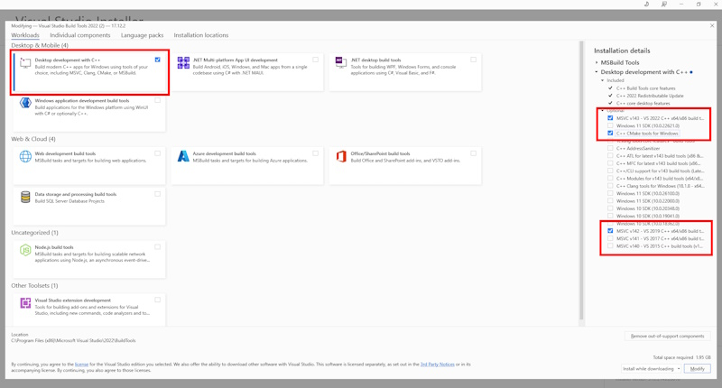

# OpenVINO&trade; Model Server Developer Guide for Windows
This document describes windows development and compilation guide for ovms.exe binary.
This instruction was tested on Windows 11 and Windows 10 OS.

## List of disabled features on Windows model server:
- cloud storage for the models - to be added in next releases
- C-API interface - to be added in next releases
- DAG pipelines - legacy feature


# Install prerequisites
Following the steps below requires 40GB of free disk space.

## VISUAL BUILD TOOLS
Install build tools for VS:

https://aka.ms/vs/17/release/vs_BuildTools.exe

Mark required options for installation:
- C++ Desktop development with C++
- Windows 11 SDK (10.0.26210.0)
- MSVC v143 CPP - VS 2022 C++ platform toolset.
- C++ CMake tools for Windows platform toolset.
- MSVC v142 CPP - VS 2022 C++ platform toolset.
- Optional Windows 11 SDK (10.0.26100.0) for Windows 10 compilation



## Power shell settings
Set Execution Policy to RemoteSigned
Open PowerShell as an administrator: Right-click on the Start button and select “Windows PowerShell (Admin)”.
Run the command:
```Set-ExecutionPolicy Unrestricted -Scope CurrentUser -Force```

## Enable Developer mode in windows system settings
Follow instructions in the link below:
https://learn.microsoft.com/en-us/windows/apps/get-started/enable-your-device-for-development

## Run Command Prompt
Press Windows Start and run the cmd.exe terminal as Administrator.
Run commands in this prompt is not stated otherwise.

## Pull OpenVINO Model Server source
> `Git` is required to complete this step. If you don't have it on your system, download it from https://git-scm.com/downloads/win and install before you continue.
Run below commands in terminal to clone model server repository:
```bat
mkdir C:\git
cd C:\git\
git clone https://github.com/openvinotoolkit/model_server.git
cd model_server
```

## Install dependencies
Run windows_install_build_dependencies.bat
This will install around 6 GB dependencies in the c:\opt directory:
- wet.exe, msys2 tools, Openvinotoolkit for GenAI, OpenCL headers, BoringSSL, bazel, Python 3.12.10, OpenCV, Curl

If error occurs during the script execution, please fix the error and rerun the script.
```bat
windows_install_build_dependencies.bat
```

Optionally, you add parameter to the windows_install_build_dependencies.bat script
```bat
windows_install_build_dependencies.bat my_dir_on_c 1 1
```
[arg1] - This way you can change default dependency install directory to c:\my_dir_on_c
[arg2] - Set the clean flag to 0 or 1 - this will cleanup the installation directories and reinstall all dependencies
[arg3] - Add the compilation integrity flag to 0 or 1 - set the additional integritycheck and Qspectre compilation flag when compiling dependencies

## COMPILE
[WARNING] This step consumes up to 13GB of disk space. It can take up to 1h depending on host CPU and internet connection speed.
```bat
windows_build.bat
```

Optionally, you add parameter to the windows_build.bat script
```bat
windows_build.bat my_dir_on_c --with_tests --integrity
```
[arg1] - Change the default dependency location to `C:\my_dir_on_c`.
[arg2..3] - Optional `--with_tests` and `--integrity` flags. They can be supplied individually or in either order.

# Running unit tests - optional
The script compiles the Python-enabled ovms_test binary, downloads and converts test LLM models (src\tests\llm_testing), and installs Python torch and optimum.
```bat
windows_test.bat
```

Optionally, pass the dependency location and a GoogleTest filter:
```bat
windows_test.bat my_dir_on_c PythonFlowTest.*
```
[arg1] - Dependency location under `C:\`; defaults to `C:\opt`.
[arg2] - GoogleTest filter; defaults to `*`.

# Running functional tests - optional
The script runs pytest tests from `tests\functional` against the ovms.exe binary from a release package. It creates a `.venv` virtual environment, installs `tests\requirements.txt` and writes results to `pytest-functional.xml`.
Create the deployment package first (see the next section) and pass the absolute path to the ovms.zip as the first argument.
A HuggingFace token is required (some tests download gated models). Provide it with the `HF_TOKEN` environment variable, or with `HF_TOKEN_FILE_PATH` pointing to a file containing the token. `HF_TOKEN` takes priority. When `HF_TOKEN_FILE_PATH` is not set, `~\ovms_tokens\huggingface_token` is used.
```bat
set HF_TOKEN=<your_huggingface_token>
windows_test_functional.bat c:\git\model_server\dist\windows\ovms.zip
```
or
```bat
set HF_TOKEN_FILE_PATH=c:\path\to\huggingface_token_file
windows_test_functional.bat c:\git\model_server\dist\windows\ovms.zip
```

Optionally, you can add parameters to the windows_test_functional.bat script
```bat
windows_test_functional.bat c:\git\model_server\dist\windows\ovms.zip "tests/functional/test_embeddings.py -k on_commit" 2
```
[arg1] - absolute path(s) to the OVMS release artifacts, comma-separated (required)  
[arg2] - pytest target(s) and options, quote when it contains spaces. Default: `tests/functional`  
[arg3] - number of pytest-xdist workers. Default: 4

Other test settings are read from `TT_*` environment variables set before running the script, for example:
```bat
set TT_TARGET_DEVICE=CPU,GPU
set TT_LOGGING_LEVEL_OVMS=DEBUG
set TT_ON_COMMIT_TESTS=False
set TT_RUN_REGRESSION_TESTS=True
windows_test_functional.bat c:\git\model_server\dist\windows\ovms.zip
```

# Creating deployment package
This step prepares ovms.zip deployment package from the build artifacts in the dist\windows\ directory. Run this script after successful compilation.
```bat
windows_create_package.bat
```

To include the embedded Python runtime, pass `--with_python` after the dependency location:
```bat
windows_create_package.bat my_dir_on_c --with_python
```
[arg1] - Dependency location under `C:\`; defaults to `C:\opt`.
[arg2] - `--with_python` includes the embedded Python runtime.

# Test the Deployment
You can follow the [baremetal deployment guide](deploying_server_baremetal.md) for information how to deploy and use the ovms.zip package.

# Developer Command Prompt
For building ovms.exe and running ovms_test.exe with manual bazel commands you must setup proper environment variables.
Run the batch script in new "Developer Command Prompt for VS 2022" terminal:
```bat
cd c:\git\model_server
windows_setupvars.bat
```

Rebuild unit tests:
```bat
bazel --output_user_root=c:\opt build --config=windows --action_env OpenVINO_DIR=c:\opt\genai/runtime/cmake --jobs=%NUMBER_OF_PROCESSORS% --verbose_failures //src:ovms_test 2>&1 | tee win_build_test.log
```

Download LLMs
```bat
%cd%\windows_prepare_llm_models.bat %cd%\src\test\llm_testing
```

Change tests configs to windows:
```bat
python windows_change_test_configs.py
```

Run specific unit tests by setting gtest_filter:
```bat
%cd%\bazel-bin\src\ovms_test.exe --gtest_filter=* 2>&1 | tee win_full_test.log
```
