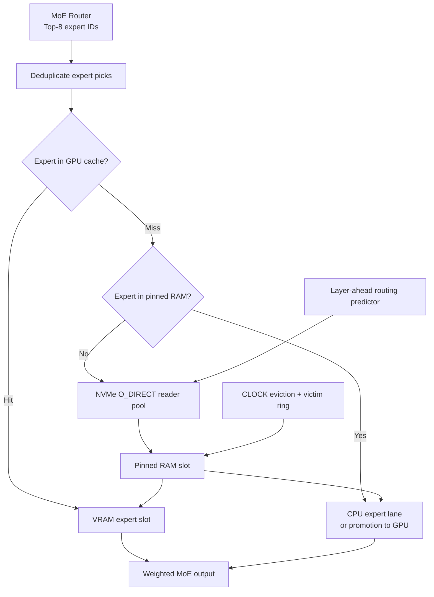
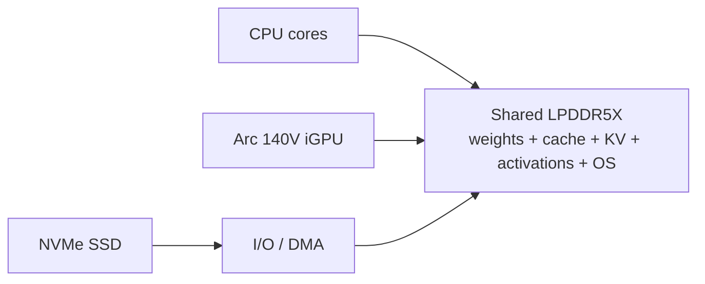
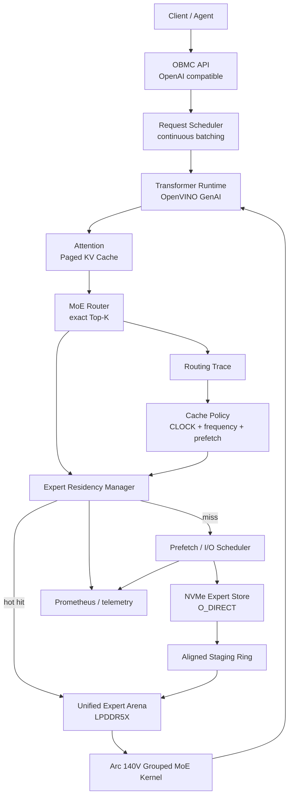
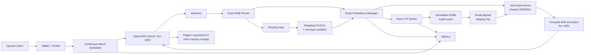

# Интеграция Routed Experts и механизмов GLM-Flash-Lite с NVMe в ОВМС на Intel Arc 140V

## Краткое резюме

В этом отчёте под **ОВМС** понимается ваша система serving для open-weight моделей. Для Intel Arc 140V наиболее практичным вычислительным backend сейчас является **OpenVINO GenAI / OpenVINO Model Server (OVMS)**, поэтому конкретная архитектура ниже ориентируется на OpenVINO, но слой `Expert Residency Manager` можно встроить и в собственный C++/Python inference runtime.

**Главный вывод: идея реализуема, но GLM-Flash-Lite нельзя переносить на Arc 140V буквально.** На эталонной машине GLM-Flash-Lite использует три физически существенно разных уровня: 24-GB VRAM RTX 3090, десятки гигабайт pinned host RAM и массив из четырёх NVMe. У Arc 140V нет такого независимого пула VRAM: это интегрированный GPU Lunar Lake, а ёмкость памяти процессора ограничена LPDDR5X; например, Core Ultra 7 258V с Arc 140V имеет максимум 32 GB памяти, 8 CPU-ядер/8 потоков и 8 Xe-ядер GPU. Поэтому для Arc правильная модель — **единый hot-tier в LPDDR5X + NVMe cold backing store**, а не `VRAM → RAM → NVMe`. citeturn21view0turn20view2

Более того, значительная часть требуемой функциональности уже появилась upstream: **OpenVINO 2026.3 официально добавил MoE offloading на диск**, прямо указывая возможность запуска 30B MoE-моделей класса Qwen3-30B-A3B на устройствах с 16 GB памяти с приемлемым TPS. А документация OVMS 2026 показывает deployment `Qwen3-30B-A3B-Instruct-2507-int4-ov` через OpenAI-compatible API, continuous batching и paged attention. Это означает, что первый прототип разумнее строить не с нуля, а поверх существующего OpenVINO disk-offload, добавляя instrumentation и routing-aware caching только там, где измерения покажут недостаток стандартной реализации. citeturn23view0turn21view6

Оценка целесообразности:

| Сценарий | Arc 140V + один NVMe + минимальная RAM | Вывод |
|---|---:|---|
| Quantized MoE примерно 20–35B total, 2–4B active | Реалистично | **Да, целевой MVP** |
| Qwen3-30B-A3B INT4 | Уже является сценарием OpenVINO disk-offload | **Лучший reference model** citeturn23view0turn21view6 |
| MoE примерно 50–100B total при малом active set | Зависит от размера dense/shared weights, SSD и cache hit rate | **Экспериментально** |
| GLM-5.3-Flash 320B/18B active | Память и I/O крайне неблагоприятны; кроме того, актуальная официальная vLLM-рецептура перечисляет NVIDIA/AMD/Ascend, а не Intel | **Не выбирать для MVP** citeturn19view6turn19view7 |
| Точное воспроизведение производительности GLM-Flash-Lite | Референс использует RTX 3090 + EPYC 24C/48T + 4× Samsung 9100 PRO RAID0 | **Нет** citeturn20view2 |
| Inference с весами экспертов на NVMe | Именно тот workload, для которого sparse MoE удобен | **Да** |
| Полный training/fine-tuning большой MoE, optimizer на NVMe | Технически offload возможен, но bandwidth hierarchy становится главным ограничением | **Практически нет для Arc 140V** citeturn17view5turn18view0 |

Самое важное ограничение формулируется так:

\[
M_{\text{usable}} >
W_{\text{dense/shared}} +
M_{\text{expert-hot}} +
M_{\text{KV}} +
M_{\text{activations}} +
M_{\text{IO-staging}} +
M_{\text{runtime+OS}}
\]

NVMe способен заменить **ёмкость для холодных весов**, но не может заменить оперативную память для всего рабочего состояния. Если под «RAM нет» понимать буквально ноль доступной DRAM, inference невозможен: ОС, драйвер GPU, page tables, command buffers, activations, KV cache и как минимум несколько I/O buffers всё равно должны физически находиться в LPDDR5X. В дальнейшем под условием пользователя я понимаю: **добавлять RAM нельзя, а единственный доступный расширяемый tier — NVMe**.

Практическая рекомендация:

> **Начинать с OpenVINO 2026.3+ / OVMS и Qwen3-30B-A3B INT4, использовать NVMe как immutable backing store для routed experts, LPDDR5X как единый execution/hot cache, O_DIRECT/asynchronous file I/O как первый custom storage backend и routing-aware CLOCK/2Q как второй этап. GLM-Flash-Lite использовать как архитектурный образец, но не как кодовую базу для прямого порта.**

## Routed Experts, маршрутизация и устройство GLM-Flash-Lite

Sparse Mixture-of-Experts возник как способ резко увеличить число параметров, не активируя их все для каждого токена. В классической работе Shazeer et al. 2017 gating network вычисляет sparse selection экспертов, после чего только выбранные экспертные FFN участвуют в обработке конкретного входа. Это принципиально отличает MoE от dense transformer: вычислительная стоимость может зависеть от **active parameters**, тогда как требования к хранению весов остаются привязаны к **total parameters**. citeturn17view1

Для serving это даёт именно тот тип локальности, который нужен NVMe-кэшу: большая часть экспертных весов существует на диске, но конкретному токену требуется только небольшой subset.

**Основные варианты routing:**

| Алгоритм | Суть | Следствие для NVMe serving |
|---|---|---|
| Sparse token-choice Top-k | Router каждого токена выбирает k экспертов | Наиболее естественная схема для expert cache; необходимо быстро разрешать `expert_id → residency` citeturn17view1 |
| Switch / Top-1 | Токен идёт только в одного эксперта; Switch Transformer упростил MoE routing и снизил communication/compute overhead | Очень удобен для дискового offload из-за меньшего working set, но применим только если модель так обучена citeturn17view2 |
| Expert Choice | Не токен выбирает эксперта, а каждый эксперт выбирает top-k токенов; проще контролировать expert capacity | Хорошо для balanced batches, но нельзя подменять им routing уже обученной token-choice модели citeturn17view3 |
| Load-balanced Top-k | Дополнительные balancing losses или router biases не дают нескольким экспертам поглотить весь traffic | Влияет на распределение cache accesses ещё при обучении |
| Auxiliary-loss-free balancing | В DeepSeek-V3 load balancing реализован без основного auxiliary loss, с дополнительным sequence-wise safeguard | Показывает, что routing policy является частью обученной модели, а не параметром storage layer citeturn17view4 |
| Trace/cache-aware serving | Сохраняется исходный routing, но история activation используется для prefetch/eviction | **Именно этот вариант нужен ОВМС**; MoE-Infinity демонстрирует эффективность trace-aware expert caching на consumer hardware citeturn17view6 |

Ключевое архитектурное правило для ОВМС:

**Storage layer не должен менять результат router.**

То есть если модель сказала:

```text
layer 17:
expert_ids = [5, 41, 77, 93, 121, 188, 211, 270]
weights    = [...]
```

Expert Cache может:

- заранее загрузить эти эксперты;
- держать часть из них в hot cache;
- менять порядок физических чтений;
- дедуплицировать обращения разных токенов;
- читать экспертов параллельно;
- предсказывать следующий expert set для prefetch.

Но он не должен заменять `expert 270` на `expert 269` только потому, что 269 уже находится в памяти. Это уже меняет функцию модели.

Русскоязычные обзоры MoE обычно описывают ту же базовую схему `router → Top-K experts`; это полезно для терминологии, однако для архитектурных решений ниже я опираюсь прежде всего на оригинальные работы и реализации. citeturn16search2

### Что именно делает GLM-Flash-Lite

GLM-Flash-Lite интересен здесь не названием модели, а тем, что он доводит идею expert paging до практически работающей системы.

Для используемой авторами квантизации **GLM-5.3-Flash EXL3 3.05 bpw** checkpoint имеет размер около **125.3 GB**, из которых **114.2 GB приходится на routed experts**. Система содержит 42 MoE-слоя по 288 экспертов размером примерно 9.44 MB; каждый токен выбирает 8 экспертов на слой, то есть выполняется 336 expert picks на токен. citeturn19view0

Для построения NVMe store проект создаёт **12 384 фиксированных expert records размером 9 474 048 bytes** — сюда входят также эксперты MTP-слоя — общей ёмкостью примерно **117.3 GB**. Reference setup хранит ещё и исходные 125.3 GB весов, поэтому установка фактически требует порядка **243 GB NVMe** до дополнительного operational headroom. citeturn23view2

Архитектура выглядит так:



Это описание соответствует нескольким конкретным механизмам проекта. GPU cache разбит на слоты экспертов; для каждого MoE-вызова система дедуплицирует выбранные router IDs, отмечает cache hits, выбирает жертвы CLOCK и переписывает per-expert pointer tables exllamav3 на фактически resident slots. citeturn17view0

RAM-tier у GLM-Flash-Lite **exclusive**, а не inclusive: если expert продвигается в VRAM, его RAM-копия освобождается; при GPU eviction эксперт возвращается в свободный RAM slot. Это разумно, потому что на дискретной RTX 3090 VRAM и host RAM — два разных scarce resources. citeturn19view1

NVMe-store хранит execution-ready records с 4-KiB alignment; первые 9 437 184 bytes записи byte-compatible с VRAM slot. Чтения выполняются через `O_DIRECT`, обходя page cache; reference implementation делит read примерно на 2304-KiB chunks и использует до 16 reader threads. citeturn17view0

У системы есть и **CPU lane**: часть экспертов, уже resident в RAM, вычисляется непосредственно 22 AVX2-потоками CPU, параллельно с GPU. Это особенно важно для понимания ограничений Arc 140V: reference CPU — EPYC 7443P с 24 cores/48 threads, тогда как, например, Core Ultra 7 258V с Arc 140V имеет всего 8 cores/8 threads. Прямое копирование CPU-lane design поэтому не имеет смысла без отдельного benchmark. citeturn19view2turn21view0

Ещё один сильный приём — **layer-ahead prefetch**. Предыдущая/текущая activation используется для получения подсказки о likely expert IDs следующего слоя, и чтения запускаются до фактического прихода computation в этот слой. Важно, что это лишь residency hint: окончательный router всё равно выполняется нормально.

Такая идея согласуется с более общими исследованиями. MoE-Infinity показывает, что при batch=1 expert activations имеют заметную temporal sparsity и что trace-aware caching/prefetching способен значительно сократить per-token latency по сравнению с обычным offload. В их тестах сообщается 3.1–16.7× снижение latency против ряда baseline систем на исследованных MoE-моделях и оборудовании; это не переносимый напрямую коэффициент для Arc 140V, но сильное подтверждение самой стратегии. citeturn17view6

### Чему из GLM-Flash-Lite стоит следовать, а чему нет

Стоит переносить:

- fixed-size или почти fixed-size execution-ready expert records;
- model manifest с digest/version/checksum;
- bypass page cache;
- asynchronous multi-request reads;
- deduplication router picks;
- explicit expert residency state;
- CLOCK-подобное eviction;
- routing-history warmup;
- one-layer-ahead prefetch;
- отдельные метрики `hot hits / prefetch hits / NVMe misses / bytes per token`;
- immutable NVMe backing store.

Не стоит переносить напрямую:

- CUDA kernels;
- `cudaHostRegister`;
- разграничение «VRAM cache» и «RAM cache»;
- 22-thread CPU expert lane;
- предположение о четырёх NVMe в RAID0;
- предположение о независимой 24-GB VRAM;
- exllamav3-specific pointer patching.

Кодовая карта самого GLM-Flash-Lite показывает CUDA device implementation и CUDA/pinned-memory зависимости, поэтому Arc 140V требует другой compute/memory backend. Авторы даже для **дискретного Arc Pro B70** реализовали отдельный Intel XPU expert server и shared ring вместо прямого использования CUDA path. citeturn19view0turn23view1

Этот эксперимент с B70, впрочем, полезен концептуально: ещё 32 GB физически отдельной GPU-памяти позволяли хранить 3000 дополнительных experts без дублирования между RTX, B70 и RAM, а reported C1 decode в конкретной reference campaign вырос с 17.48 до 26.40–26.61 tok/s. Это демонстрирует ценность **дополнительной ёмкости resident experts**, но Arc 140V такой ёмкости не добавляет — он использует системный memory budget. citeturn23view1

## NVMe как внешний уровень рабочей памяти

Для routed experts NVMe правильнее считать **persistent backing store**, а не настоящей RAM.

Эксперты после загрузки модели неизменяемы. Поэтому ideal workflow выглядит так:

```text
model checkpoint
      ↓ one-time conversion
expert.pack + manifest
      ↓
NVMe = authoritative cold storage
      ↓ cache misses
LPDDR5X = hot executable working set
      ↓
Arc 140V execution
```

Важное следствие: нет необходимости постоянно записывать expert cache обратно на SSD. Eviction обычно означает просто `drop resident copy`, потому что authoritative bytes уже лежат на NVMe. Это делает workload почти полностью **read-only**, что одновременно упрощает consistency и уменьшает износ SSD.

### Сравнение storage backends

| Backend | RAM overhead | Latency predictability | Реализация | Пригодность |
|---|---:|---:|---|---|
| Buffered file I/O | Высокий: Linux page cache начинает конкурировать с LLM | Средняя/низкая | Очень простая | Плохо при минимальной RAM |
| `mmap()` checkpoint | OS управляет paging автоматически | Низкая при pressure/page faults | Очень простая | Только baseline |
| File + `O_DIRECT` + async reads | Небольшой и контролируемый | Высокая | Средняя | **Рекомендуемый основной вариант** |
| Raw block device + SPDK | Очень низкий cache overhead | Очень высокая | Высокая сложность, отдельный driver model | Только после доказанного bottleneck |
| RocksDB / KV-store | Index/block cache + metadata | Средняя | Удобно для variable records | Не для critical expert path |
| Отдельные файлы на expert | Metadata/filesystem overhead | Средняя | Просто | Нежелательно при тысячах experts |
| Один packed immutable file | Минимальный | Высокая | Просто вычислять offset | **Оптимальный формат** |

Linux определяет `O_DIRECT` именно как механизм минимизации влияния page cache с передачей данных непосредственно в userspace buffers; это соответствует случаю, когда приложение само управляет caching. Именно такой подход использует GLM-Flash-Lite. citeturn21view2turn17view0

`mmap` удобен, но при маленькой RAM отдаёт решение о residency ядру, тогда как serving runtime знает намного больше: текущий layer, router IDs, следующий вероятный expert set и deadline. Поэтому explicit pager имеет принципиально больше информации для принятия решения. Практические русскоязычные разборы `mmap` также отмечают меньшую управляемость asynchronous prefetch по сравнению с явным asynchronous I/O. citeturn16search3

RocksDB технически способен хранить `expert_key → bytes`, но его основной persistent representation — SST, а block-based SST дополнительно предполагает поиск block и RAM block cache. Для immutable records с заранее известным `(layer, expert_id) → offset` этот lookup stack не даёт преимуществ, но добавляет metadata, cache и потенциальную write/compaction machinery. citeturn21view4

SPDK, напротив, действительно предоставляет user-space polled asynchronous NVMe driver, zero-copy-oriented path и lockless message passing, уменьшая syscall/interrupt overhead и latency variance. Но polling постоянно расходует CPU, а на Lunar Lake с восемью CPU threads это гораздо более существенная цена, чем на EPYC reference host. Поэтому SPDK следует рассматривать как **Stage 2 optimization**, а не стартовую архитектуру. citeturn21view3turn21view0

### Рекомендуемый формат expert store

Для ОВМС я бы использовал один immutable файл:

```text
model.experts.pack

+------------------------+ offset 0
| optional file header   |
+------------------------+ 4 KiB aligned
| layer 0 / expert 0     |
+------------------------+
| layer 0 / expert 1     |
+------------------------+
| ...                    |
+------------------------+
| layer N / expert M     |
+------------------------+
```

И отдельный небольшой:

```json
{
  "format_version": 1,
  "model_id": "...",
  "model_digest": "...",
  "quantization": "INT4",
  "alignment": 4096,
  "experts": [
    {
      "layer": 0,
      "expert": 0,
      "offset": 4096,
      "length": 5242880,
      "sha256": "..."
    }
  ]
}
```

GLM-Flash-Lite использует ту же фундаментальную идею: фиксированные records, alignment и manifest/checksum. citeturn17view0turn23view2

При conversion стоит по возможности хранить эксперт **сразу в формате, пригодном MoE kernel**, а не в generic tensor serialization. Иначе cache miss превратится в цепочку:

```text
NVMe read
→ deserialize
→ transpose
→ dequantize/repack
→ execution
```

вместо:

```text
NVMe read
→ register/copy to hot arena
→ execution
```

Именно поэтому byte-compatible expert slot в GLM-Flash-Lite является очень сильной инженерной идеей. citeturn17view0

### I/O-паттерн

Для decode основной pattern не похож ни на database OLTP, ни на последовательный streaming:

```text
token t
 layer 0 → expert 7, 11, ...
 layer 1 → expert 4, 98, ...
 layer 2 → expert 17, 18, ...
 ...
```

То есть обращения:

- read-only;
- достаточно крупные;
- pseudo-random по всему pack file;
- имеют сильную temporal locality;
- имеют известный layer ordering;
- имеют очень строгий latency deadline;
- допускают prefetch на один-два слоя;
- допускают dedup внутри batch.

Для single-SSD Arc-системы я бы начинал с reads порядка **1–8 MiB**, queue depth примерно 4–32 и небольшого числа I/O workers, после чего параметры определял бы `fio`- и end-to-end-тестами. Размеры здесь являются параметрами эксперимента, а не требованиями NVMe.

GLM-Flash-Lite на совсем другом storage subsystem — 4× Samsung 9100 PRO RAID0 — измеряет 6.7–8.9 GB/s при некоторых serving режимах, до 19.9 GB/s во время C1 decode при 16-GiB cap и около 26 GB/s ceiling; средний record-read latency составлял 1.2–1.4 ms под нагрузкой и примерно 0.75 ms изолированно. **Эти результаты нельзя переносить на одиночный laptop SSD**, но они показывают, насколько агрессивен bandwidth demand у огромного GLM. citeturn19view2

### Persistence и crash recovery

Expert store должен быть immutable:

```text
build temp file
    ↓
checksum all records
    ↓
fsync
    ↓
write manifest
    ↓
fsync
    ↓
atomic rename / generation activation
```

В runtime resident cache является disposable:

```text
process crash
→ RAM cache lost
→ manifest remains valid
→ restart
→ warm from routing statistics
→ normal operation
```

Persisting LRU state не требуется. Имеет смысл сохранять только очень компактную статистику popularity, например:

```text
(layer_id, expert_id, hits)
```

и делать это редко, чтобы cache subsystem оставался read-mostly.

**KV cache — другая сущность.** Это runtime state, производный от пользовательского prompt. По умолчанию его не следует писать на постоянный NVMe вместе с weights. OpenVINO/OVMS уже использует paged-attention-oriented serving, поэтому сначала следует уменьшать и ограничивать KV in-memory, а disk spill добавлять только для suspended sessions, а не для активного token loop. OVMS официально поддерживает continuous batching и paged attention для LLM serving. citeturn21view6

Наконец, не следует путать runtime expert cache с `OpenVINO cache_dir`. Обычный OpenVINO model cache сохраняет compiled device blobs и ускоряет последующую compilation/load; структура cache может зависеть от plugin/device/version. Это полезный **startup cache**, но не замена runtime expert pager. citeturn15search1turn15search13

## Ограничения Intel Arc 140V и реальная граница реализуемости

Intel Core Ultra 7 258V — показательный представитель платформы Arc 140V: 8 CPU cores/8 threads, до 32 GB LPDDR5X-8533 и Arc 140V с 8 Xe cores; Intel указывает 64 INT8 GPU TOPS. citeturn21view0

Для нашего дизайна важнее не TOPS, а memory architecture.

На дискретном GPU:

```text
GPU VRAM 24 GB
     ↑ PCIe
Host RAM 55+ GB
     ↑ PCIe
NVMe
```

На Arc 140V архитектуру правильнее концептуально представлять так:



То есть «GPU expert cache» и «CPU RAM expert cache» расходуют одну и ту же физическую ёмкость. Поэтому **exclusive three-tier cache GLM-Flash-Lite превращается в two-tier cache**:

```text
Unified LPDDR5X hot expert arena
                ↕
             NVMe
```

Небольшой staging ring остаётся нужен, но он должен измеряться десятками или сотнями MiB, а не десятками GiB.

### Почему GLM-5.3-Flash особенно плохой target

Официальная GLM-5.3-Flash имеет примерно **320B total / 18B active parameters**. В актуальной vLLM recipe указаны 45 layers, routing 8 из 288 experts и native checkpoint порядка 306 GiB FP8 до runtime/KV overhead. citeturn19view6turn19view7

GLM-Flash-Lite за счёт EXL3 3.05 bpw уменьшает это примерно до:

```text
total checkpoint       ≈ 125.3 GB
routed experts         ≈ 114.2 GB
non-expert portion     ≈  11.1 GB
```

citeturn19view0

Уже `~11.1 GB` non-expert weights создают критическую проблему для 16-GB unified system.

Иллюстративный бюджет, **не benchmark**:

| Память Arc-системы | OS/runtime reserve | Non-expert GLM weights | Условный KV/activation reserve | Остаток под experts |
|---|---:|---:|---:|---:|
| 16 GB | 4 GB | 11.1 GB | хотя бы несколько GB | **Не помещается** |
| 32 GB | 4 GB | 11.1 GB | 4 GB | ~12.9 GB |
| 32 GB, большой context | 4 GB | 11.1 GB | 8+ GB | <9 GB |

При expert record около 9.47 MB даже гипотетический 12-GB hot arena соответствует лишь порядка 1.2–1.3 тыс. experts.

У reference GLM-Flash-Lite ситуация принципиально другая: при режиме «16 GiB cap + NVMe» эти 16 GiB host memory существуют **в дополнение к 24 GB RTX 3090 VRAM**, а storage состоит из четырёх NVMe RAID0, CPU — 24C/48T EPYC. На такой системе проект сообщает 14.38 tok/s C1. При 55-GiB cap — 19.47 tok/s, причём только 23 expert picks/token в одном измерении требовали NVMe: около 120 обслуживались VRAM и 175 RAM, из которых 152 шли через CPU lane. citeturn20view0turn20view2

Поэтому утверждение

> «GLM-Flash-Lite работает с 16 GB RAM, значит Arc 140V 16 GB тоже должен»

было бы неверным. Это совершенно разные physical memory budgets.

### Что происходит с разными типами памяти модели

| Состояние | Можно держать на NVMe? | Arc 140V recommendation |
|---|---|---|
| Cold routed-expert weights | Да, идеально | **Основной NVMe payload** |
| Dense/shared weights | Теоретически можно стримить | Желательно держать resident; слишком часто используются |
| Embeddings / norm / routers | Формально можно | Resident |
| Активный expert | Нет в момент исполнения | Обязательно materialize в LPDDR5X |
| Activations | Только как очень медленный spill | Resident |
| Active KV cache | Возможен disk spill, но latency-sensitive | Resident/quantized/paged |
| Suspended-session KV | Да | Опциональный async spill |
| Optimizer states | Только при training | В serving отсутствуют |
| Gradients | Только при training | В serving отсутствуют |
| Routing statistics | Да | Маленький persistent metadata file |

**Activations нельзя «заменить NVMe».** Compute kernel должен получить операнды из GPU-accessible memory. Можно построить pipeline, в котором activation blocks освобождаются и восстанавливаются, но синхронное чтение NVMe внутри каждого матричного оператора уничтожит latency.

**Optimizer states в inference отсутствуют вообще.** Если цель в дальнейшем изменится на training, ситуация резко ухудшается. ZeRO-Infinity показывает, что parameters/optimizer states действительно можно offload в CPU/NVMe и вычислять tiles последовательно, но авторы отдельно подчёркивают огромный bandwidth gap между GPU memory, CPU memory и NVMe; optimizer processing с NVMe требует постоянного чтения и обратной записи chunks. Это архитектурно возможный, но совсем другой workload. citeturn17view5turn18view0

Поэтому на Arc 140V:

- full pretraining — исключить;
- full fine-tuning большой MoE — исключить;
- LoRA/adapter training маленькой модели — отдельная задача;
- inference routed MoE — **реалистичная цель**.

### Лучший target для первого прототипа

На текущем software stack гораздо сильнее выглядит Qwen3-30B-A3B INT4, чем GLM-5.3-Flash.

OpenVINO 2026.3 прямо объявляет disk offload для 30B MoE и приводит Qwen3-30B-A3B как пример модели, способной работать на устройствах с 16 GB памяти. OVMS 2026.4 документация одновременно показывает готовую команду запуска `OpenVINO/Qwen3-30B-A3B-Instruct-2507-int4-ov` и GPU deployment через `/dev/dri`. citeturn23view0turn21view6

GLM-5.3-Flash же на текущий момент следует рассматривать прежде всего как **источник design patterns**, а не как первый deployment target: официальная vLLM recipe для него перечисляет NVIDIA Hopper+, AMD gfx950 и Huawei Ascend, но не Intel GPU, а сам GLM-Flash-Lite построен поверх CUDA/exllamav3. citeturn19view7turn19view0

## Рекомендуемая архитектура интеграции в ОВМС

Я бы реализовывал интеграцию в два уровня: сначала использовать существующий OpenVINO disk offload как production baseline, затем — только при подтверждённой необходимости — внедрять собственный GLM-Flash-Lite-style pager.

### Общая архитектура



**Первый вариант — рекомендуемый MVP.**

```text
OVMS 2026.3+
   ↓
OpenVINO GenAI
   ↓
existing MoE disk offload
   ↓
Arc 140V + NVMe
```

В таком варианте задача сначала не «написать pager», а выяснить:

1. какой TPS уже даёт upstream;
2. какой фактический RAM peak;
3. сколько reads/token;
4. какой SSD bandwidth достигается;
5. где GPU простаивает;
6. есть ли смысл заменять cache policy.

Это особенно рационально потому, что upstream уже официально поддерживает сам use case Qwen3-30B-A3B + disk offload, тогда как повторение всего stack с нуля создаст огромный implementation risk. citeturn23view0

**Второй вариант — custom Expert Pager.** Он нужен, если upstream:

- не предоставляет достаточной observability;
- вызывает слишком много SSD misses;
- использует неоптимальный для вашей модели storage layout;
- не позволяет routing-aware prefetch;
- не поддерживает выбранный open-weight MoE.

### Компоненты

| Компонент | Ответственность | Где размещать |
|---|---|---|
| OVMS/API Gateway | OpenAI API, request lifecycle | Existing OVMS |
| Continuous Batch Scheduler | Batch formation, admission control | OpenVINO GenAI / ОВМС |
| Model Registry | Model generation, digests, manifests | ОВМС |
| Router Tap | Получить exact `expert_ids` и weights | MoE graph/kernel boundary |
| Expert Residency Manager | `expert → state/location` | In-process C++ |
| Unified Expert Arena | GPU-accessible hot experts | LPDDR5X |
| I/O Scheduler | Async `pread`/`io_uring`, priorities | C++ |
| NVMe Expert Store | Immutable records | NVMe filesystem |
| Prefetch Predictor | Следующий likely expert set | Runtime |
| Eviction Policy | Решает, что удалить | Residency Manager |
| KV Manager | Active KV / limits / optional spill | Existing GenAI |
| Telemetry | hit rate, TPOT, bytes/token, queue | Prometheus/OpenTelemetry |
| Integrity Manager | checksums, model generations | Model Registry |

Критический hot-path лучше держать **in-process**, а не выносить Expert Manager в HTTP/gRPC microservice. На cache miss добавлять RPC latency к NVMe latency нет смысла.

Предлагаемый C++ API достаточно маленький:

```cpp
struct ExpertKey {
    uint32_t layer;
    uint32_t expert;
};

struct ExpertHandle {
    const void* device_accessible_ptr;
    size_t size;
    uint64_t generation;
};

class ExpertStore {
public:
    virtual Future<ExpertHandle> acquire(
        std::span<const ExpertKey> keys,
        Deadline deadline) = 0;

    virtual void release(
        std::span<const ExpertHandle> handles) = 0;

    virtual void prefetch(
        std::span<const ExpertKey> keys,
        int priority) = 0;

    virtual ExpertStoreStats stats() const = 0;
};
```

`acquire()` должен обладать следующей семантикой:

```text
router IDs
   ↓
deduplicate
   ↓
lookup residency table
   ├─ READY   → pin and return
   ├─ READING → join existing future
   └─ ABSENT  → allocate slot → enqueue NVMe read
```

Рекомендуемая state machine:

```text
ABSENT
  ↓ read requested
READING
  ↓ checksum / completion
READY
  ↓ kernel uses expert
PINNED
  ↓ kernel completion
READY
  ↓ selected as victim
EVICTING
  ↓
ABSENT

READING → CORRUPT on integrity failure
```

Это решает важную проблему **thundering herd**: если четыре tokens/concurrent requests одновременно потребовали `(layer=15, expert=73)`, storage layer должен сделать один physical read, а остальные requests должны присоединиться к тому же `Future`.

### Routing и prefetch

Алгоритм каждого MoE layer:

```text
router(hidden)
    ↓
exact top-k IDs + weights
    ↓
deduplicate across tokens in microbatch
    ↓
lookup residency
    ↓
hits: pin immediately
misses: async load
    ↓
execute grouped MoE
    ↓
weighted combine
    ↓
unpin
```

В дополнение:

```text
current hidden / routing trace
       ↓
next-layer predictor
       ↓
likely expert IDs
       ↓
low-priority asynchronous prefetch
```

Но prefetch requests должны быть отменяемыми/понижаемыми по priority. **Demand miss всегда приоритетнее speculative prefetch.**

GLM-Flash-Lite использует именно layer-ahead prefetch как residency hint, а MoE-Infinity показывает преимущества использования activation traces для replacement/prefetch. citeturn17view0turn17view6

На Arc 140V я бы **не запускал CPU expert lane в первой версии**. В reference GLM implementation CPU lane использует 22 AVX2 threads, тогда как Lunar Lake 258V располагает только восемью CPU threads; те же CPU нужны I/O completion, scheduling, tokenization и OS. citeturn19view2turn21view0

Добавлять CPU execution следует только если benchmark покажет:

```text
GPU waiting for NVMe
+
expert already present in CPU-visible memory
+
CPU execution < load-to-GPU/execution latency
```

Поскольку Arc 140V уже использует shared memory, benefit может оказаться гораздо меньше, чем в RTX architecture.

### Cache policy

GLM-Flash-Lite использует CLOCK. Это хороший baseline: он дешёвый и избегает тяжёлых data structures в hot path. citeturn17view0

Но для ОВМС я бы сделал **Routing-Aware Weighted CLOCK**.

Для каждого resident expert:

\[
KeepScore =
\alpha R +
\beta F +
\gamma P_{next} +
\delta C_{reload} +
\eta S
\]

где:

- \(R\) — recency;
- \(F\) — exponentially decayed frequency;
- \(P_{next}\) — вероятность использования в ближайших слоях;
- \(C_{reload}\) — стоимость повторного NVMe load;
- \(S\) — session affinity.

В первой версии достаточно:

```text
CLOCK reference bit
+
EWMA hit count
+
prefetch flag
```

Eviction priority:

```text
NEVER EVICT:
  pinned/current-kernel experts

EVICT LAST:
  high-frequency demand-loaded experts

EVICT EARLIER:
  old experts

EVICT FIRST:
  prefetched-but-never-used experts
```

Сравнение:

| Policy | CPU overhead | Реакция на temporal locality | Routing-awareness | Рекомендация |
|---|---:|---:|---:|---|
| FIFO | Минимальный | Плохая | Нет | Нет |
| LRU | Средний | Хорошая | Нет | Baseline |
| CLOCK | Низкий | Хорошая | Нет | **MVP** |
| LFU | Средний | Может «залипать» | Частично | Не самостоятельно |
| 2Q / segmented LRU | Средний | Очень хорошая | Нет | Хорошая альтернатива |
| Trace-aware CLOCK | Низкий/средний | Очень хорошая | Да | **Целевая policy** |

### Unified-memory hot arena

На Arc не нужны отдельные:

```text
GPU cache
RAM cache
```

Я бы использовал:

```text
+---------------------------------------+
| Unified LPDDR5X                       |
|                                       |
| OS/runtime reserve                    |
| Dense/shared weights                  |
| KV cache                              |
| Activations                           |
|                                       |
| Expert Hot Arena                      |
| [slot][slot][slot]...[slot]           |
|                                       |
| I/O staging ring                      |
+---------------------------------------+
```

Arena должна быть строго bounded.

При запуске:

```text
MemAvailable
 - mandatory_os_reserve
 - dense_weights
 - max_KV_budget
 - activation_budget
 - runtime_margin
 - staging
 = expert_arena_capacity
```

Если результат отрицательный, server должен **отказать в загрузке модели**, а не надеяться на swap.

Linux swap на тот же NVMe вместе с expert store особенно нежелателен: uncontrolled anonymous-memory swapping начнёт конкурировать с управляемыми expert reads.

### Не предполагать SSD→GPU direct DMA

Для первой реализации не следует проектировать систему так, будто Arc 140V имеет эквивалент NVIDIA GPUDirect Storage.

Без доказанной поддержки конкретным Level Zero/OpenVINO path безопасное предположение такое:

```text
NVMe
  ↓ DMA
aligned CPU/shared buffer
  ↓ ownership/cache synchronization
GPU-accessible expert arena
```

На integrated GPU последняя операция потенциально дешевле, чем PCIe-copy в dGPU, но всё равно остаются allocation, synchronization и cache-coherence costs. Их нужно измерять, а не считать нулевыми.

### Consistency

Weights должны быть versioned immutable objects:

```text
model_generation = SHA256(
    architecture +
    quantization +
    tensor_layout +
    expert_store_manifest
)
```

Каждый cache entry получает `generation`.

Таким образом:

```text
model v1 requests → expert cache v1
model v2 preload  → separate generation
atomic switch
new requests      → v2
old requests      → finish on v1
v1 cache          → garbage collect
```

Нельзя модифицировать expert pack in-place во время serving.

GLM-Flash-Lite также проверяет expert store и хранит checksums в manifest, что подтверждает практичность такого подхода. citeturn17view0

### Fault tolerance

| Сбой | Поведение |
|---|---|
| Cache entry потерян | Повторный read с NVMe |
| Process crash | Перестроить hot cache после restart |
| Checksum mismatch | Retry; затем model unhealthy |
| NVMe I/O timeout | Cancel/retry с ограничением; не зависать бесконечно |
| SSD исчез | Model state → `UNAVAILABLE` |
| Expert record отсутствует | Не заменять другим expert; fail request/model |
| Manifest не соответствует model | Отказать при startup |
| Недостаточно RAM для minimum working set | Отказать при admission |
| Prefetch queue переполнена | Drop speculative requests |
| Demand queue переполнена | Backpressure на request scheduler |

**Approximate fallback вида «нужного expert нет — используем другой resident expert» делать нельзя**, если модель специально не обучалась для такой схемы.

### Security

Expert store стоит монтировать read-only после conversion. Process должен работать без root; документация OVMS для Linux сама демонстрирует контейнерный доступ к Intel GPU через `/dev/dri` и соответствующую render group, а не полный privileged container. citeturn21view6

Дополнительно:

- pin model revision и container digest;
- проверять hashes expert store;
- не принимать произвольные file paths из API;
- ограничивать размер manifests и record offsets;
- не давать storage process raw-device privileges на MVP;
- API публиковать через authentication/TLS reverse proxy;
- KV/session spill шифровать либо отключать;
- очищать reusable buffers, если они могут содержать user-derived state;
- хранить weights и user KV в разных directories/volumes.

GLM-Flash-Lite setup сам рекомендует pin image/model revision и держать его неаутентифицированный server только на `127.0.0.1`, что является хорошим напоминанием: локальный benchmark API нельзя просто выставлять наружу. citeturn23view2

Raw SPDK повышает operational и security complexity, поскольку NVMe controller переводится в user-space driver model. Поэтому file-based `O_DIRECT` заметно безопаснее как стартовая точка. SPDK оставлять для ситуации, когда профилирование докажет, что Linux I/O stack, а не сам SSD, является bottleneck. citeturn21view3

## Производительность, bottlenecks и benchmarks

Самая полезная метрика для NVMe MoE — не просто SSD GB/s.

Нужно измерять:

\[
\textbf{NVMe bytes per generated token}
\]

Она напрямую связывает routing/cache efficiency с storage bandwidth.

Если:

- \(N_m\) = число NVMe expert misses на токен;
- \(S_e\) = средний размер expert record;
- \(B\) = sustained usable NVMe bandwidth,

то:

\[
D_{token}=N_m S_e
\]

и нижняя граница времени только на передачу данных:

\[
T_{IO,min} \approx \frac{D_{token}}{B}
\]

Это optimistic bound: он предполагает идеальную очередь I/O, отсутствие дополнительных latency stalls и достаточный parallelism.

### GLM-подобный пример

Возьмём размер expert record GLM-Flash-Lite:

\[
S_e \approx 9.474\text{ MB}
\]

citeturn23view2

Для **условных**, а не заявленных для Arc, sustained rates 4 и 6 GB/s:

| NVMe misses/token | Данные/token | I/O floor при 4 GB/s | Bandwidth-only ceiling | I/O floor при 6 GB/s | Bandwidth-only ceiling |
|---:|---:|---:|---:|---:|---:|
| 10 | 94.7 MB | 23.7 ms | 42.2 tok/s | 15.8 ms | 63.3 tok/s |
| 20 | 189.5 MB | 47.4 ms | 21.1 tok/s | 31.6 ms | 31.7 tok/s |
| 40 | 379.0 MB | 94.7 ms | 10.6 tok/s | 63.2 ms | 15.8 tok/s |
| 80 | 757.9 MB | 189.5 ms | 5.3 tok/s | 126.3 ms | 7.9 tok/s |

Это **не прогноз скорости модели**. Это лишь показывает fundamental consequence: doubling cache misses приблизительно удваивает требуемый NVMe traffic.

Если storage и GPU compute идеально overlap:

\[
TPOT \gtrsim \max(T_{compute}, T_{exposed\ IO})
\]

Если overlap плохой:

\[
TPOT \approx T_{compute} + T_{exposed\ IO}
\]

Поэтому увеличение cache hit rate с 80% до 90% может оказаться гораздо ценнее перехода с хорошего kernel I/O на чуть более быстрый SSD.

Reference GLM-Flash-Lite подтверждает это эмпирически: в одной 55-GiB run на токен примерно 120 picks обслуживались VRAM, 175 RAM и только 23 NVMe. Такая небольшая доля NVMe accesses была достигнута благодаря примерно 4830 experts в RAM tier плюс GPU cache. citeturn20view0

У Arc 140V с минимальной unified RAM такой большой second-level expert cache отсутствует. Поэтому главный риск — не raw NVMe latency, а **miss amplification**.

### Основные bottlenecks

| Bottleneck | Почему опасен | Признак |
|---|---|---|
| Недостаточный hot cache | Слишком много experts/token читаются с SSD | `nvme_misses/token` высокий |
| SSD bandwidth | Expert records крупные | SSD постоянно 90–100% busy |
| Read latency | Один demand miss может остановить layer | высокий TPOT p95/p99 |
| Плохой prefetch | SSD читает ненужные experts | низкий prefetch precision |
| Малый prefetch horizon | I/O не успевает скрыться compute | GPU idle перед MoE |
| Слишком агрессивный prefetch | Вытесняет useful cache и забивает queue | demand latency растёт |
| Unified-memory pressure | KV/activations конкурируют с experts | cache hit падает с context length |
| Memory bandwidth contention | GPU matmul и NVMe DMA используют LPDDR | GPU throughput падает при I/O |
| CPU saturation | I/O workers + scheduler + tokenization | CPU 100%, completion latency растёт |
| Thermal throttling | Laptop CPU/GPU/SSD работают одновременно | TPS деградирует со временем |
| Cache thrashing при concurrency | Разные requests активируют разные experts | C2/C4 хуже C1 |
| Long-context KV | KV вытесняет expert slots | misses/token растёт с prompt length |

Reference host GLM-Flash-Lite очень хорошо показывает, насколько hardware-sensitive эта задача: RTX 3090 24 GB, EPYC 7443P 24C/48T, 503 GiB DDR4 и четыре Samsung 9100 PRO в RAID0. Даже сами авторы отмечают session-to-session performance drift до примерно 17% на их host и требуют сравнивать настройки back-to-back. citeturn20view0turn20view2

Следовательно, переносить их цифры `19.47 tok/s` или `14.38 tok/s` на Arc 140V нельзя.

### Особенность concurrency

MoE + NVMe имеет интересный trade-off.

Увеличение concurrency может:

**помочь**, потому что:

```text
больше outstanding reads
→ выше NVMe queue utilization
→ лучше bandwidth
```

но одновременно:

**навредить**, потому что:

```text
больше sequences
→ больше KV
→ больше expert working set
→ меньше cache hit rate
→ больше eviction
```

Поэтому производительность должна измеряться минимум при:

```text
C1
C2
C4
```

а не только single request.

OVMS уже поддерживает continuous batching и paged attention, поэтому experiment следует проводить поверх этого scheduler, а не создавать искусственный single-request-only runtime. citeturn21view6

### Storage microbenchmarks

Перед model benchmark:

```text
fio / custom pread test
```

Матрица:

| Parameter | Значения |
|---|---|
| Read size | 256 KiB, 1 MiB, 2 MiB, 4 MiB, actual expert size |
| QD | 1, 4, 8, 16, 32 |
| Pattern | random read |
| Mode | buffered vs direct |
| Threads | 1, 2, 4, затем больше только если помогает |
| Dataset | > доступной RAM |
| Runtime | достаточно долгий для steady state |

Метрики:

```text
GB/s
p50 read latency
p95
p99
CPU %
context switches
device queue depth
SSD temperature
```

Обычный sequential benchmark SSD почти бесполезен: expert serving гораздо ближе к крупным random reads с deadlines.

### Expert-cache microbenchmark

Следующим уровнем должен стать **trace replay** без полного LLM.

Сохранить реальные routing traces:

```text
token_id, layer_id, expert_ids[]
```

а затем воспроизводить их против cache simulator/pager.

Для каждой policy измерять:

\[
HitRate = \frac{hits}{expert\ requests}
\]

\[
MissBytesPerToken =
\frac{NVMe\ bytes}{generated\ tokens}
\]

\[
PrefetchPrecision =
\frac{prefetched\ experts\ actually\ used}
     {all\ prefetched\ experts}
\]

\[
PrefetchRecall =
\frac{future\ demand\ satisfied\ by\ prefetch}
     {future\ demands}
\]

Плюс:

```text
evictions/token
duplicate-read suppression
average residency lifetime
prefetch wasted bytes/token
demand queue p95
```

Так можно сравнить LRU/CLOCK/trace-aware policy за минуты, не выполняя каждый раз GPU inference.

### End-to-end model benchmark

Минимальная матрица:

| Dimension | Набор |
|---|---|
| Concurrency | 1, 2, 4 |
| Prompt | 1k, 8k, 32k tokens |
| Decode | 128, 512+ tokens |
| Cache | cold / warm |
| Disk offload | upstream / custom |
| Prefetch | off / on |
| Policy | CLOCK / routing-aware |
| RAM budget | фактический production limit |

Метрики serving:

**Latency**

```text
TTFT
TPOT mean
TPOT p50
TPOT p95
TPOT p99
inter-token jitter
```

**Throughput**

```text
prompt tok/s
decode tok/s
aggregate tok/s
requests/s
```

**Memory**

```text
process RSS
MemAvailable
expert arena size
KV bytes
activation/runtime peak
```

**Expert cache**

```text
expert_requests/token
hot_hits/token
nvme_misses/token
hit ratio
unique experts/token
evictions/token
prefetch precision
prefetch recall
```

**Storage**

```text
NVMe MB/token
GB/s
read latency p50/p95/p99
queue depth
read amplification
write bytes
```

**Compute**

```text
GPU busy %
CPU %
I/O worker %
time waiting for expert
time in MoE kernel
time in attention
```

### Quality validation

На MVP cache должен менять только местоположение expert bytes, поэтому quality ideally должна совпадать с non-offloaded execution в пределах обычной floating-point/quantization nondeterminism.

Тест:

```text
same model
same prompt
same seed
same sampling config

resident baseline
vs
NVMe-offloaded path
```

Сравнивать:

```text
top-1 agreement
max logits error
mean logits error
KL divergence
generated-token agreement
```

GLM-Flash-Lite также использует KL/top-1 comparison для проверки своих approximate/CPU execution paths; в их опубликованной summary `nvme` mode показывает небольшой, но ненулевой KL относительно reference, тогда как exact paths предназначены для bit-exact behaviour. citeturn20view0

Для нашей первой реализации лучше целиться в **route-exact + mathematically same expert kernel**, не добавляя approximate expert substitution.

### Что считать успехом на Arc 140V

Для первого production-worthy результата я бы задал не абсолютный TPS, а такие gates:

```text
1. No OOM for agreed max context.
2. No swap storms.
3. Cache miss read p99 bounded.
4. No corrupted/mismatched experts.
5. Quality equivalent to resident baseline.
6. Stable throughput for 30+ min thermal soak.
7. Demand I/O never starved by prefetch.
8. SSD writes near zero during ordinary inference.
```

И только после этого оптимизировать tok/s.

## Дорожная карта, риски и итоговая рекомендация

Наиболее важное обстоятельство на октябрь 2026 года — OpenVINO уже двинулся именно в нужную сторону: версия 2026.3 официально объявила **MoE offloading to disk** для 30B-класса, а OVMS предоставляет OpenAI-compatible serving, continuous batching и paged attention на Intel GPU. Поэтому проект лучше строить как **измеряемое развитие существующего Intel stack**, а не как port CUDA GLM-Flash-Lite. citeturn23view0turn21view6

Предлагаемый roadmap:

| Этап | Реализация | Критерий завершения |
|---|---|---|
| Hardware characterization | Определить точный CPU SKU, 16/32 GB RAM, SSD model, PCIe link, filesystem, OS/kernel/OpenVINO | Есть reproducible hardware report |
| Upstream baseline | OpenVINO/OVMS + Qwen3-30B-A3B INT4 + native disk offload | Модель стабильно отвечает |
| Observability | Добавить TTFT/TPOT, RSS, SSD GB/s, GPU busy, cache/offload counters | Видно, куда уходит время |
| Router tracing | Получить реальные expert activation traces | Можно replay traces |
| Cache simulator | CLOCK/LRU/trace-aware policy offline | Найдена policy лучше baseline |
| Packed expert store | Immutable aligned records + checksums | Store deterministic/recoverable |
| Async pager | O_DIRECT + bounded staging + read deduplication | Expert reads работают без page-cache explosion |
| Routing-aware prefetch | Demand priority + one-layer prefetch | NVMe misses/TPOT уменьшаются |
| OVMS integration | In-process ExpertStore interface | OpenAI API остаётся неизменным |
| Hardening | Fault injection, checksum, SSD loss, OOM admission, security | Predictable failure modes |
| Large-MoE experiment | Только после успеха 30B-class | Решение о 50–100B/GLM-like targets |

Для этапа baseline следует использовать именно documented OpenVINO/OVMS path, а не сразу переносить GLM. OpenVINO 2026.3 уже заявляет соответствующий 16-GB disk-offload use case, а current OVMS guide показывает Qwen3-30B-A3B INT4 deployment непосредственно через OpenVINO model format. citeturn23view0turn21view6

### Главные риски

| Риск | Вероятность | Влияние | Mitigation |
|---|---|---|---|
| LPDDR5X слишком мало даже для dense/shared + KV | Высокая на 16 GB | Критическое | Smaller MoE, INT4, KV limits, admission check |
| Cache misses слишком частые | Высокая для огромных MoE | Критическое | Routing-aware cache, smaller model |
| Один NVMe недостаточно быстр | Средняя/высокая | Высокое | Reduce bytes/token прежде, чем менять I/O stack |
| Prefetch увеличивает traffic | Средняя | Среднее/высокое | Strict priority + precision metrics |
| Unified memory contention | Средняя | Высокое | Bounded arena, measure GPU busy vs DMA |
| OpenVINO internal offload API недостаточно расширяем | Средняя | Среднее | Сначала upstream mode; custom pager за abstraction boundary |
| Выбранная модель не поддержана Intel kernels | Высокая для GLM-5.3 | Критическое | Qwen3-MoE MVP |
| SPDK отнимает CPU/pрава | Высокая | Среднее | Не использовать в MVP |
| Thermal degradation | Средняя | Среднее | 30–60 min soak benchmark |
| SSD failure | Низкая/средняя | Высокое | Immutable checksum store, reproducible rebuild |
| SSD wear | Низкая при read-only design | Среднее | Не persist runtime cache/KV по умолчанию |
| Quality drift | Низкая при exact routing | Высокое | Logit/KL regression suite |
| Context growth вытесняет experts | Высокая | Высокое | Explicit KV budget |
| OS swap вмешивается в paging | Средняя | Критическое | Не полагаться на swap; bounded allocations |

### Рекомендуемая конечная архитектура

Итоговый target я бы формулировал так:



В этой схеме NVMe — **не виртуальная видеопамять общего назначения**, а специализированный persistent storage для наиболее подходящего к offload класса данных: **редко используемых immutable expert weights**.

Именно sparse routed experts делают такую архитектуру значительно привлекательнее, чем попытку запускать dense 100B+ модель из SSD: router заранее сообщает, какие небольшие фрагменты огромного parameter space действительно нужны этому токену.

### Итоговая оценка

**Для Arc 140V проект имеет смысл, если целью является MoE примерно 20–35B total / несколько миллиардов active parameters, квантизованный до INT4/сходного формата.** Наличие официального OpenVINO disk-offload для Qwen3-30B-A3B на 16-GB-class systems является самым сильным практическим подтверждением feasibility. citeturn23view0

**GLM-Flash-Lite следует использовать как design reference:** packed expert records, `O_DIRECT`, explicit residency, CLOCK, deduplication, routing statistics, layer-ahead prefetch и immutable NVMe store — все эти решения хорошо переносятся концептуально. citeturn17view0turn19view1turn19view2

**Сам GLM-Flash-Lite переносить буквально не следует.** Его референсная эффективность опирается на три независимых memory/storage tiers, CUDA/exllamav3, 24-GB RTX 3090, мощный 24-core EPYC и четырёхдисковый NVMe RAID0. Arc 140V имеет совсем другой memory topology и гораздо меньший CPU budget. citeturn20view2turn21view0

**GLM-5.3-Flash 320B — плохой первый target.** Даже после очень агрессивной EXL3-квантизации GLM-Flash-Lite всё ещё оперирует 125.3 GB checkpoint, 114.2 GB routed experts и ~9.44-MB expert records; reference installation дополнительно создаёт 117.3-GB packed expert store. На Arc 140V отсутствие большого RAM tier резко увеличит NVMe miss rate, а текущие официальные deployment paths GLM-5.3 не ориентированы на Intel Arc. citeturn19view0turn23view2turn19view7

**Оптимальная последовательность реализации поэтому такова:**

`OpenVINO native disk offload → Qwen3-30B-A3B baseline → routing telemetry → cache simulator → routing-aware CLOCK → O_DIRECT packed pager → только затем более крупные MoE`.

Это минимизирует риск и позволяет проверить главный вопрос раньше, чем будет написан сложный storage engine: **сколько NVMe bytes/token реально остаётся после разумного expert caching на конкретном Arc 140V и конкретном объёме LPDDR5X**. Именно эта величина, а не номинальные TOPS GPU или рекламный sequential bandwidth SSD, в конечном счёте определит, будет ли NVMe-backed MoE на этой машине интерактивным.
